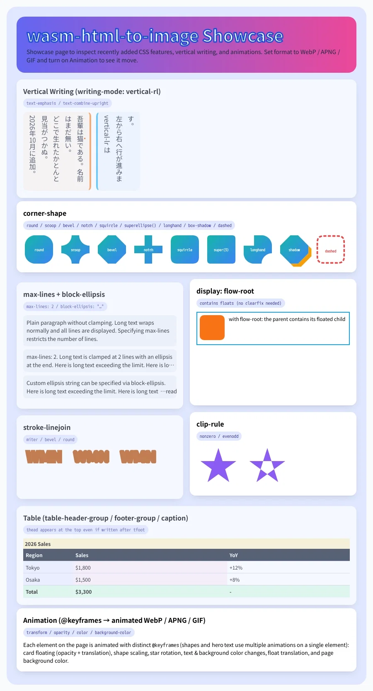
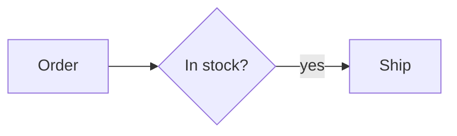

# wasm-html-to-image

[](https://www.npmjs.com/package/wasm-html-to-image)
[](https://www.npmjs.com/package/wasm-html-to-image)
[](https://github.com/SoraKumo001/wasm-html-to-image/blob/master/LICENSE)
[](https://sorakumo001.github.io/wasm-html-to-image/master)
[](https://sorakumo001.github.io/wasm-html-to-image/master/docs/)
[](https://github.com/SoraKumo001/wasm-html-to-image-samples)

A high-performance HTML-to-image renderer and image processing engine powered by a single WebAssembly module.  
Supports modern CSS, **vertical writing (`writing-mode: vertical-rl`)**, and **CSS animations** (`@keyframes` to animated WebP / APNG / GIF).

**No Chromium / Puppeteer.** **No native dependencies (Sharp / ImageMagick).**  
Runs seamlessly across **Node.js**, **Cloudflare Workers**, **Edge runtimes**, **browsers**, and the **CLI**.

---

## ⚡ What Can It Do?

| Feature | Description | Formats |
| :--- | :--- | :--- |
| 🌐 **HTML / React to Image** | Render HTML/CSS strings or React JSX directly to high-quality images | PNG, JPEG, WebP, AVIF, JXL, SVG |
| ⛩️ **Vertical Writing** | Full CJK vertical text support (`writing-mode: vertical-rl` / `vertical-lr`) with HarfBuzz shaping | PNG, JPEG, WebP, AVIF, PDF |
| 🎬 **CSS Animation to WebP / GIF** | Record CSS `@keyframes` animations directly into animated image formats | Animated WebP, APNG, GIF |
| 🔗 **URL to Screenshot** | Capture remote web pages without launching a browser | PNG, WebP, JPEG, AVIF |
| 📑 **Multi-Page Vector PDF** | Generate crisp, selectable vector PDFs from HTML or images | PDF |
| 🖼️ **Image Resizing & Optimization** | Fast format conversion, crop, and resize (Sharp alternative) | WebP, AVIF, JXL, PNG, JPEG |
| 📝 **Markdown to PDF** | GitHub-flavoured Markdown to a styled, paged PDF: 11 templates, cover, contents, bookmarks, maths, syntax highlighting, call-outs, footnotes | PDF, PNG, WebP |
| 🧜 **Mermaid Diagrams** | 26 diagram types drawn by the engine itself as vectors (no browser, no Mermaid JS): in Markdown, in HTML, or alone with `renderMermaid()` | SVG, PNG, WebP, JPEG, AVIF, JXL, PDF |
| 🪶 **ThumbHash Blur Placeholder** | Generate compact blur placeholders for instant progressive loading | ThumbHash |


Supports vertical writing mode and CSS animations:

<p align="center">
  
</p>

---

## 📦 Installation

```bash
npm install wasm-html-to-image
```

---

## 🚀 Quick Start

One single function — `render()` — handles HTML rendering, vertical text, animations, URL capturing, and image processing:

```typescript
import { render } from "wasm-html-to-image";

// 1. Render HTML (Supports modern CSS & Vertical Writing)
const result = await render({
  value: `<div style="writing-mode: vertical-rl; font-family: sans-serif; padding: 40px; background: #0f172a; color: white;">
    <h1 style="margin: 0; font-size: 28px;">日本語縦書きレイアウト</h1>
    <p style="opacity: 0.8;">Vertical writing with HarfBuzz text shaping</p>
  </div>`,
  width: 500,
  height: 600,
  format: "png",
});
console.log(result.data); // Uint8Array
console.log(result.width, result.height); // 500, 600

// 2. Record CSS Animation -> Animated WebP / APNG / GIF
const animated = await render({
  value: `<style>
    @keyframes spin { to { transform: rotate(360deg); } }
    .spinner { width: 80px; height: 80px; border: 8px solid #f3f3f3; border-top: 8px solid #6366f1; border-radius: 50%; animation: spin 1.5s linear infinite; }
  </style><div class="spinner"></div>`,
  format: "webp",
  animation: 1500, // duration in ms
  animationFps: 20,
});

// 3. Capture a URL screenshot
const screenshot = await render({
  url: "https://example.com",
  width: 1200,
  height: 630,
  format: "webp",
});

// 4. Convert & Resize an image (JPEG -> AVIF)
const avif = await render({
  value: imageBuffer, // Pass raw Uint8Array / Buffer directly
  width: 400,
  format: "avif",
  quality: 80,
});
```

---

## 💻 CLI Usage

Render from your terminal without writing code:

```bash
# Render HTML to WebP
npx wasm-html-to-image template.html -o banner.webp -w 1200 -h 630 -f webp -q 90

# Render HTML with vertical writing
npx wasm-html-to-image tategaki.html -o tategaki.png -w 600 -h 800

# Convert CSS animation into Animated WebP or GIF
npx wasm-html-to-image loader.html -o loader.webp -f webp --animation 2000 --animation-fps 20
npx wasm-html-to-image loader.html -o loader.gif -f gif --animation 2000

# Inline HTML (starts with <) or stdin (-); the format follows the output extension
npx wasm-html-to-image '<h1 style="color:red">Hello</h1>' -o hello.webp
echo '<h1>Hello</h1>' | npx wasm-html-to-image - -o hello.png

# Register local fonts (repeatable, globs allowed)
npx wasm-html-to-image card.html --font './fonts/*.woff2' -w 1200 -h 630 -o og.webp

# Stand in for a system font the page asks for (the engine cannot see system fonts)
npx wasm-html-to-image https://go.dev/ --font "Segoe UI=C:/Windows/Fonts/segoeui.ttf" -w 1600 -o go.png

# Several weights of one family: repeat --font, each file keeps its own weight and style,
# and `font-weight` picks the nearest one (a single Regular file is never emboldened)
npx wasm-html-to-image https://go.dev/ -w 1600 -o go.png \
  --font "Segoe UI=C:/Windows/Fonts/segoeui.ttf" --font "Segoe UI=C:/Windows/Fonts/segoeuib.ttf"

# Run the page's scripts first (Node only; jsdom is an optional dependency, trusted pages only)
npx wasm-html-to-image https://go.dev/ --js -w 1600 -o go.png
npx wasm-html-to-image https://example.com/ --js --js-wait '#app .ready' -o app.png   # or --js-wait 2000 (ms)

# Capture screenshot from URL
npx wasm-html-to-image https://example.com -o site.png -w 1280 -h 720

# Convert and resize an image (JPEG -> AVIF)
npx wasm-html-to-image photo.jpg -o photo.avif -w 800 -f avif -q 80
```

---

## 📊 Supported Formats

### Inputs (`value` / `url`)
- **HTML String**: Standard HTML & CSS (Flexbox, Grid, gradients, custom fonts, **vertical writing (`writing-mode: vertical-rl` / `vertical-lr`)**, `@keyframes` animations).
- **HTML Array (`string[]`)**: Multi-page PDF generation (one page per array item).
- **URL (`url`)**: Automatically fetches and renders remote web pages.
- **Image Buffer / Data URL**: `PNG`, `JPEG`, `WebP`, `GIF`, `AVIF`, `JXL`, `BMP`.

### Outputs (`format`)
`png`, `jpeg`, `webp`, `avif`, `jxl`, `apng`, `gif`, `tiff`, `svg`, `pdf`, `thumbhash`, `raw` (uncompressed RGBA).

**Print colors:** `format: "tiff"` keeps RGBA; add `colorSpace: "cmyk"` (CLI: `--color-space cmyk`) to get a CMYK TIFF, or a PDF whose colors and images are DeviceCMYK. The conversion is the plain device formula (no ICC profile), so convert with your print shop's profile if you need exact press colors. For print resolution, add `scale` (CLI: `--scale`): an 8.33in-wide page at 300 dpi is `width: 800, scale: 3.125`, and the TIFF records `96 × scale` ppi (override with `dpi`).

Every call returns a `RenderResult` object:
```typescript
interface RenderResult {
  data: Uint8Array | string; // Binary bytes (or string for SVG)
  width: number;
  height: number;
  originalWidth: number;
  originalHeight: number;
  format: string;
  isAnimated: boolean;
}
```

---

## 🌐 Environments & Subpaths

| Subpath | Target Environment | Highlights |
| :--- | :--- | :--- |
| `wasm-html-to-image` | Universal (Node, Edge, Cloudflare, Deno) | **Zero-config default**: auto-routes to single or workerd |
| `wasm-html-to-image/single` | Node.js, Bundlers | Single bundled WASM binary |
| `wasm-html-to-image/index` | High-throughput servers | Explicit `loadHtmlToImageModule()` & instance reuse |
| `wasm-html-to-image/workerd` | Cloudflare Workers | Optimized for `WebAssembly.Module` compilation |
| `wasm-html-to-image/edge-light` | Vercel Edge Runtime | Tailored for strict Edge constraints |
| `wasm-html-to-image/workers` | Node.js, Web Workers | Multi-threaded worker pool for high concurrency |
| `wasm-html-to-image/react` | React integration | Directly render React JSX element trees |
| `wasm-html-to-image/preact` | Preact integration | Directly render Preact JSX element trees |
| `wasm-html-to-image/tailwind` | Utility styling | UnoCSS / Tailwind v4 utilities (`createCSS`, `tailwind()`) |
| `wasm-html-to-image/markdown` | Markdown input | GitHub-flavoured Markdown to a styled HTML page (`markdownToHtml`); pure JS, runs in browsers and Workers |
| `wasm-html-to-image/single`, `/workers` | Mermaid diagrams | `renderMermaid(source, options)`: one diagram as an SVG string or an image (`renderMermaidWith` on `/workerd` and `/edge-light`) |
| `wasm-html-to-image/markdown-math` | Maths in Markdown | KaTeX renderer for `markdownToHtml({ math })`: `$...$` and `$$...$$` (`katexMath`); pure JS, runs in browsers and Workers |

---

## 💡 Advanced Examples

<details>
<summary><b>Markdown to image / PDF</b></summary>

The [playground](https://sorakumo001.github.io/wasm-html-to-image/master/?mode=markdown) has a *Markdown to PDF* mode: edit the text, pick a template and theme, switch the cover, contents, bookmarks and maths, and see the PDF as it changes. A *Templates* view draws the same text with every bundled template side by side. The settings are in the URL (and remembered for the next visit), so a look can be shared as a link.

`markdownToHtml` (from the `wasm-html-to-image/markdown` subpath, built on [marked](https://github.com/markedjs/marked)) turns GitHub-flavoured Markdown into a complete HTML page with a built-in GitHub-like stylesheet. It is plain JavaScript, so it works in Node, browsers and Cloudflare Workers alike; pass the result to `render()` as `value`:

```ts
import { render } from "wasm-html-to-image";
import { markdownToHtml } from "wasm-html-to-image/markdown";

const html = markdownToHtml("# Hello\n\n- **bold** and `code`", { theme: "dark", maxWidth: 720 });
const { data } = await render({ value: html, width: 800, format: "pdf" });
```

Options: `theme` (`"light"` | `"dark"`), `css` (appended after the built-in sheet), `stylesheet` (replaces it), `padding`, `maxWidth`, `title`, `highlight` (fenced code with a known language is syntax-highlighted; default on), `frontMatter` (a leading `---` YAML block is dropped and its `title` becomes the page title; default on), `paged` (for PDF: `padding` becomes the margin of every page, so pages after the first keep their top and bottom margins; the CLI sets it for `.pdf` output, in code pass `paged: true` with `format: "pdf"`), `toc` (see below; on for paged output). Headings stay with the text after them and code blocks, tables and quotes are not split across pages.

The CLI does the same for `.md` / `.markdown` files, and for inline text or stdin with `--markdown`:

```bash
npx wasm-html-to-image README.md -o readme.png -w 800
npx wasm-html-to-image notes.md -o notes.pdf --markdown-theme dark --markdown-css extra.css
npx wasm-html-to-image "# Hello" --markdown -o hello.png
```

Highlighted languages: bash/shell, c, c++, c#, css/scss, diff, dockerfile, go, html/xml/svg, ini/toml, java, javascript, json, kotlin, markdown, php, python, ruby, rust, sql, swift, typescript, yaml (and the usual aliases such as `js`, `ts`, `sh`, `py`). Other fences stay plain.

**Templates.** A template is a look you pick by name and adjust with a few settings, no CSS needed. It sets the typography, the PDF page (size, margins, running header and footer) and whether the document has a cover and a contents page. Colours are separate (`theme: "light" | "dark"`), so every template comes in both.

| Template | For | Look |
| :--- | :--- | :--- |
| `default` | images, quick PDFs | the GitHub-like page |
| `report` | business documents | A4, cover, contents, headings and links in the accent colour, the title in the header, author and `n / N` in the footer |
| `proposal` | proposals, quotations | A4, cover, accent bars on sections, tinted table headers, call-out quotes |
| `book` | books, long reading | A5, serif, justified, each chapter (`h1`) on a new page, a cover and contents, the page number in the footer |
| `paper` | papers, technical notes | A4, serif, justified, tight leading, the page number in the footer |
| `compact` | notes, cheat sheets | 12px text, 12mm margins, no cover or contents |
| `manual` | manuals, specifications | A4, cover, contents, numbered headings, each chapter on a new page, call-outs |
| `minutes` | meeting minutes | A4, no cover, ruled title, tinted table headers, title and date in the header |
| `letter` | letters, notices | A4, serif, wide margins; `.right` and `.center` classes for the address block |
| `slides` | presentations | A4 landscape, large text, each `h2` on its own page, with a cover |
| `invoice` | invoices, quotations | A4, large right-aligned title, accent table header, emphasised last row |

Pick one in the front matter or the options, and set the document's own details there too:

```md
---
title: Quarterly report<br>Q3 2026
subtitle: Product development
author: Taro Yamada
date: 2026-10-29
template: report
accent: "#c2410c"      # links, headings and the cover rule
font: serif            # body font (any family the renderer can load)
page_size: A4          # A3 A4 A5 B4 B5 Letter, or two lengths: 210mm 297mm
stamp: DRAFT           # printed in the header of every page
cover: true            # a cover from title, subtitle, author, date and logo
toc: false             # no contents page
logo: https://example.com/logo.png
lang: en               # <html lang>
numbering: true        # number the headings 1, 1.1, 1.1.1
orientation: landscape # turn the page sideways
margin: 20mm 18mm      # page margin (a CSS margin value)
footer: "{{title}} {{pageNumber}} / {{totalPages}}"   # replaces the template's footer (header: works the same)
toc_depth: 2           # deepest heading in the contents
toc_title: Contents    # heading of the contents page
cover_style: center    # band | plain | center
---
```

Precedence is *template defaults < front matter < options*, so a template can be a starting point that one document tweaks and one build overrides. Keys this package does not know are ignored (front matter is shared with other tools). With a cover, the cover page carries no running header or footer (it still counts as page 1).

**More than plain Markdown.**

- Call-outs: a block quote starting with `[!NOTE]`, `[!TIP]`, `[!IMPORTANT]`, `[!WARNING]` or `[!CAUTION]` becomes a coloured box.
- Figures: `` becomes a figure captioned `Figure 1  Title`.
- `<!-- pagebreak -->` forces a new page; `[^name]` and `[^name]: text` make footnotes collected at the end.
- Code lines wrap instead of being cut, and tables span the text width in `report`, `proposal`, `book`, `paper`, `manual`, `minutes`, `slides` and `invoice`.
- Fenced `mermaid` blocks are drawn as diagrams (see the Mermaid section below).

```ts
import { render } from "wasm-html-to-image";
import { markdownToDocument, listTemplates } from "wasm-html-to-image/markdown";

// markdownToHtml(md, opts) is the page alone; markdownToDocument also returns what a PDF needs
// besides it: the template's header and footer, the PDF's title and author.
const { html, renderOptions } = markdownToDocument(md, { template: "report", paged: true, settings: { stamp: "DRAFT" } });
const { data } = await render({ value: html, format: "pdf", ...renderOptions });
```

```bash
npx wasm-html-to-image --list-templates
npx wasm-html-to-image report.md -o report.pdf --template report --stamp DRAFT --accent "#c2410c"
npx wasm-html-to-image notes.md  -o notes.pdf  --template compact --page-size A5 --no-toc
npx wasm-html-to-image book.md   -o book.pdf   --template ./my-look.json     # your own, see below
```

Your own template is data too: pass an object as `template`, or give the CLI a `.json` file with the same shape, or a `.css` file that is laid over the default look.

```json
{
  "type": { "font": "serif", "size": 14, "lineHeight": 1.7, "justify": true, "h1Rule": false, "chapterBreak": true },
  "page": { "size": "B5", "margin": "18mm", "footer": "<div style=\"text-align:center;font-size:10px\">{{pageNumber}}</div>" },
  "defaults": { "cover": true, "toc": true, "accent": "#0f766e" },
  "css": ".markdown-body blockquote { font-style: italic }"
}
```

`type` takes `font`, `headingFont`, `mono`, `size` (px), `lineHeight`, `justify`, `h1Rule`, `h2Rule`, `headingWeight`, `accentHeadings`, `chapterBreak`, `radius` and `wideTables`; `page` takes `size`, `margin` (a CSS `margin`), `header` and `footer` (HTML with `{{pageNumber}}`, `{{totalPages}}`, `{{title}}`, `{{author}}`, `{{date}}`, `{{stamp}}`). Anything left out comes from the default template. A template can instead start from a bundled one with `extends` (its own fields are laid over the base's, and `css` is appended); write colours as `var(--surface)`, `var(--border)`, `var(--muted)`, `var(--text)` and `var(--accent)` so it follows the dark theme too: `defineTemplate({ extends: "report", defaults: { accent: "#0f766e" } })`. A cover is built from `<header class="cover">` with `cover-title`, `cover-subtitle`, `cover-meta` and `cover-logo` inside, so `css` can restyle it; its title is not an `h1`, so it stays out of the bookmarks and the contents.

**Table of contents and bookmarks.** A PDF made from Markdown starts with a table of contents and carries bookmarks, both on by default:

- Every heading gets an `id` (a slug of its text: any script, lower-cased, duplicates numbered `-2`, `-3`) and the contents lists the headings down to `toc.depth` (default 3). Each row is a link to its heading and shows the page the heading lands on, filled in once the pages are planned (the contents' own pages included, so the numbers are right however long the list is).
- The bookmarks (the viewer's outline panel) come from `h1`-`h6`, nested by level; a heading that `break-after: avoid` moved is bookmarked where it ended up.
- Links like `[see](#setup)` in the text are clickable in the PDF, wrapped lines included.

```ts
markdownToHtml(md, { paged: true });                                        // contents on (the default for PDF)
markdownToHtml(md, { paged: true, toc: { depth: 2, title: "目次" } });      // shallower, own title ("" for none)
markdownToHtml(md, { paged: true, toc: false });                            // no contents page
await render({ value: html, format: "pdf", pdfOutline: false });            // no bookmarks
```

```bash
npx wasm-html-to-image book.md -o book.pdf                  # contents + bookmarks
npx wasm-html-to-image book.md -o book.pdf --toc-depth 2    # shallower contents
npx wasm-html-to-image book.md -o book.pdf --no-toc         # no contents page
npx wasm-html-to-image book.md -o book.pdf --no-outline     # no bookmarks
```

Images get no contents by default (there are no pages to number); pass `toc: true` to add one anyway.

It works for plain HTML too: the renderer turns every `<a href="#id">` into a link to the element with that `id`, and replaces the text of any element with `data-toc-page="id"` by the page that element starts on, so a hand-written contents page can use `<a href="#intro">Intro <span data-toc-page="intro"></span></a>`. Destination names are spelled in ASCII inside the PDF (a non-ASCII `id` becomes `u` + its UTF-8 in hex) because Skia writes them differently for a destination and a link, which only agree for ASCII.

**Maths.** `$...$` (inline) and `$$...$$` (display) are typeset with [KaTeX](https://katex.org) when you pass a renderer. It lives in its own subpath so that `markdownToHtml` stays small for those who do not need it:

```ts
import { markdownToHtml } from "wasm-html-to-image/markdown";
import { katexMath } from "wasm-html-to-image/markdown-math";

const html = markdownToHtml("Euler: $e^{i\\pi} + 1 = 0$\n\n$$\n\\frac{-b \\pm \\sqrt{b^2 - 4ac}}{2a}\n$$", {
  math: katexMath(), // { fontBase: "https://my.host/katex/fonts" } to self-host the fonts
});
```

Prices stay prices (`It costs $5 and $10`: the closing dollar must follow a non-space and not precede a digit), `\$` is a literal dollar, and code spans and fences are left alone. TeX that KaTeX rejects is shown as its source with the error as a tooltip instead of failing the page. The output is KaTeX's HTML (no MathML), so it works in Node, browsers and Workers; its fonts are fetched while the page is drawn, from the jsDelivr copy of the matching KaTeX version unless you set `fontBase`. The CLI turns maths on whenever `katex` is installed (`--no-math` switches it off).

`marked`, `highlight.js` and `katex` are optional dependencies, installed with the package by default (the Markdown subpath is about 280 kB when bundled for a browser; the KaTeX one is about 520 kB on top of it, mostly KaTeX itself).

</details>

<details>
<summary><b>Mermaid diagrams (SVG / image / PDF)</b></summary>

The engine draws Mermaid diagrams itself, as vectors: no browser, no Puppeteer, no Mermaid JavaScript. Text is measured with the real fonts, so Japanese labels fit exactly. Three ways to use it:

````md

````

```html
<div class="mermaid">sequenceDiagram
  A->>B: Hello</div>
```

```ts
import { renderMermaid } from "wasm-html-to-image/single"; // also "/workers"

const { data: svg } = await renderMermaid("graph LR\n  A --> B"); // an SVG string
const { data: png } = await renderMermaid("graph LR\n  A --> B", { format: "png", theme: "nord" }); // bytes
```

- **26 diagram types**: flowchart, sequence, state, class, ER, requirement, block, C4 (five kinds), architecture, Gantt, pie, XY chart, quadrant, radar, Sankey, treemap, Venn, mind map, timeline, user journey, git graph, kanban, packet, Ishikawa, tree view and `info`. An unsupported one (`zenuml`, ...) shows an error box where the diagram would be.
- **Themes**: `light`, `dark`, `neutral`, `forest`, `nord`, `dracula`, `solarized-light`, `solarized-dark`, `rose-pine`, `sepia`; or set `--mermaid-theme`, `--mermaid-fg`, `--mermaid-bg`, `--mermaid-accent`, ... in CSS.
- **Formats**: SVG (a string), PNG, WebP, JPEG, AVIF, JXL and PDF; the image is sized to the diagram.
- **Input repair** (`mode`): `strict` (default) reports every mistake, with a "did you mean" hint for a near-miss keyword; `compat` also accepts a keyword in the wrong case, CRLF and unfinished `end` / `}`; `recover` also fixes a misspelt keyword and skips lines it cannot read.
- `classDef` / `class` / `style` (flowchart, state, class, ER, block), `accTitle` / `accDescr` (they become the SVG `<title>` / `<desc>`), and, with `directives: true`, `%%{init}%%` and frontmatter `config:`.

From the command line: `npx wasm-html-to-image flow.mmd -o flow.png --mermaid-theme nord` (a `.mmd` / `.mermaid` file, or `--mermaid` for inline text and stdin).

Try every diagram, theme and format in the [playground](https://sorakumo001.github.io/wasm-html-to-image/master/?mode=mermaid); its *Gallery* draws all the samples at once. Details: the *Mermaid Conversion* page of the documentation.

</details>

<details>
<summary><b>0. Pages that build themselves with JavaScript (jsdom, Node only)</b></summary>

The engine never runs scripts. The `javascript` option loads the page into [jsdom](https://github.com/jsdom/jsdom)
(an optional dependency, installed with the package by default; `npm i --omit=optional` skips it), lets its scripts run, and renders the resulting DOM:

```typescript
import { render } from "wasm-html-to-image/single";

const { data } = await render({
  url: "https://go.dev/",
  width: 1600,
  javascript: true, // or { timeout: 10000, settleMs: 1000, waitFor: "#app .ready" }
});
```

- It waits for `load`, then `settleMs` (default 1000 ms) or until `waitFor` matches, at most `timeout` (default 10 s).
- Only scripts are fetched by jsdom; stylesheets, images and fonts stay with the renderer. `<noscript>` content is dropped.
- jsdom has no layout (`getBoundingClientRect` returns zeros, `ResizeObserver` / `IntersectionObserver` are stubs) and does not run
  `type="module"` scripts. Failing scripts are ignored.
- jsdom is not a security sandbox (`runScripts: "dangerously"`): use it only with pages you trust.
- Available from the `single` entry point and the CLI (`--js`, `--js-wait`); the edge/worker entry points ignore it.

</details>

<details>
<summary><b>1. High-Throughput Node.js Server (Module Instance Reuse)</b></summary>

Reuse the compiled WASM module across incoming HTTP requests for maximum performance:

```typescript
import { loadHtmlToImageModule, htmlToImage } from "wasm-html-to-image";
import express from "express";

const app = express();
const mod = await loadHtmlToImageModule(); // Load once at startup

app.get("/ogp", async (req, res) => {
  const result = await htmlToImage(mod, {
    value: `<h1>${req.query.title}</h1>`,
    width: 1200,
    height: 630,
    format: "webp",
    quality: 85,
  });

  res.type("image/webp").send(Buffer.from(result.data));
});

app.listen(3000);
```
</details>

<details>
<summary><b>2. Cloudflare Workers (Edge OGP Generator)</b></summary>

```typescript
import { render } from "wasm-html-to-image"; // auto-selects the workerd build

export default {
  async fetch(request: Request): Promise<Response> {
    const result = await render({
      value: `<div style="padding: 40px; font-family: sans-serif; background: #0f172a; color: white;">
        <h1>Edge OGP Generator</h1>
      </div>`,
      width: 1200,
      height: 630,
      format: "png",
    });

    return new Response(result.data, {
      headers: {
        "Content-Type": "image/png",
        "Cache-Control": "public, max-age=86400",
      },
    });
  },
};
```
</details>

<details>
<summary><b>3. Multi-Threaded Batch Generation (`workers`)</b></summary>

Leverage multi-core CPUs with worker threads to render hundreds of images in parallel:

```typescript
import { render } from "wasm-html-to-image/workers";

const tasks = items.map((item) =>
  render({
    value: `<h1>${item.title}</h1>`,
    width: 600,
    height: 400,
    format: "webp",
  }),
);

const images = await Promise.all(tasks);
```
</details>

<details>
<summary><b>4. Image Cropping & ThumbHash</b></summary>

```typescript
import { render } from "wasm-html-to-image";

// Crop and resize
const cropped = await render({
  value: imageBuffer,
  crop: { x: 50, y: 50, width: 300, height: 300 },
  width: 150,
  height: 150,
  format: "png",
});

// Generate ThumbHash blur placeholder
const thumbhash = await render({
  value: imageBuffer,
  width: 100,
  format: "thumbhash",
});
```
</details>

---

## 📖 Documentation & Examples

👉 **[Read the Official Documentation](https://sorakumo001.github.io/wasm-html-to-image/master/docs/)**  
👉 **[Sample Code & Projects (GitHub)](https://github.com/SoraKumo001/wasm-html-to-image-samples)**

- [Overview & Getting Started](https://sorakumo001.github.io/wasm-html-to-image/master/docs/docs/overview)
- [Architecture & Pipelines](https://sorakumo001.github.io/wasm-html-to-image/master/docs/docs/architecture)
- [API Reference](https://sorakumo001.github.io/wasm-html-to-image/master/docs/docs/api-reference)
- [Runtime Guide (Node / Workers / Edge / Browser)](https://sorakumo001.github.io/wasm-html-to-image/master/docs/docs/api-reference/runtime-guide)
- [Production Recipes](https://sorakumo001.github.io/wasm-html-to-image/master/docs/docs/recipes/ogp-production)

---

## 🛠️ Development

<details>
<summary>Click to view repository build and test instructions</summary>

### Prerequisites

- Node.js >= 20, pnpm >= 9
- Emscripten SDK (emsdk), CMake, Ninja, vcpkg (for C++ WASM builds)

### Building

```bash
# Install workspace dependencies
pnpm install

# Build TypeScript packages
pnpm --filter wasm-html-to-image build
pnpm build:js

# Build Documentation
pnpm docs:build
```

### Testing

```bash
# Unit tests (Vitest)
pnpm --filter wasm-html-to-image test

# Visual regression tests
pnpm --filter visual-test test
```

</details>

---

## 📄 License

MIT © [SoraKumo](https://github.com/SoraKumo001)
