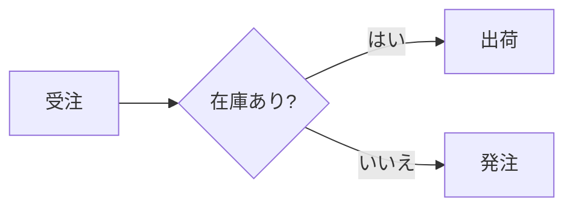

# Markdown 変換 (`/markdown`)

`wasm-html-to-image/markdown` は、GitHub Flavoured Markdown（GFM）を美しくスタイリングされた HTML ページや PDF ドキュメント用データに変換するモジュールです。

純粋な JavaScript で実装されているため、Node.js だけでなくブラウザや Cloudflare Workers 等のエッジ環境でも軽量・高速に動作します。

---

## 主な機能

- **`markdownToDocument()` & `markdownToHtml()`**: Markdown から HTML および PDF 用オプション（ヘッダー、フッター、タイトル等）を生成。
- **テンプレートシステム**: 6 つの組み込みテンプレート（`default`, `report`, `proposal`, `book`, `paper`, `compact`）を提供。CSS を書かずにプロ品質のレイアウトが可能。
- **自動目次（TOC）とページ番号連携**: 見出しから目次ページを自動生成。PDF レンダラーと連携して正確な開始ページ番号を自動挿入。
- **PDF ブックマーク（アウトライン）自動生成**: `h1`〜`h6` 見出しから PDF ビューワーの目次ツリー（アウトライン）を自動構築。
- **スマートな改ページ制御**: 見出し直後の孤立改ページ防止（`break-after: avoid`）やコードブロック・表の分断防止。
- **YAML Front Matter**: 文書先頭のメタデータ（タイトル、著者、テンプレート、余白、スタンプ等）を自動解釈。
- **シンタックスハイライト**: highlight.js を内蔵し、20 種類以上の主要言語のコードブロックを色分け表示。
- **Mermaid 図**: ` ```mermaid ` をフローチャート・シーケンス・状態・クラス・ER・グラフとしてエンジン内で描画。
- **KaTeX 数式レンダリング (`/markdown-math`)**: インライン `$…$` およびブロック `$$…$$` 数式を高精度に組版。

---

## 基本的な使い方

### 1. Markdown から PDF を生成

PDF を作成する場合は、`markdownToDocument()` を使用してページ HTML と PDF 用オプション（テンプレートのヘッダー・フッターなど）を取得し、`render()` に渡します。

```typescript
import fs from "node:fs/promises";
import { render } from "wasm-html-to-image";
import { markdownToDocument } from "wasm-html-to-image/markdown";

const md = `---
title: 四半期業績報告書
subtitle: 2026年度 第3四半期
author: 山田 太郎
date: 2026-10-29
template: report
accent: "#2563eb"
stamp: 社内限り
---

# エグゼクティブサマリー

本四半期の売上高は前年同期比 **+15.2%** と堅調に推移しました。

# 主要指標

| 指標 | 目標 | 実績 |
| :--- | :--- | :--- |
| 売上総利益 | 5,000万円 | 5,420万円 |
| 新規顧客数 | 120社 | 135社 |
`;

// HTML と PDF レンダリング用オプションを取得
const { html, renderOptions } = markdownToDocument(md, {
  paged: true, // PDF 向けページ余白・改ページ最適化を有効化
});

const { data } = await render({
  value: html,
  format: "pdf",
  ...renderOptions,
});

await fs.writeFile("report.pdf", Buffer.from(data));
```

### 2. 単一画像（PNG / WebP）として描画

画像として出力する場合は `markdownToHtml()` を使用します。

```typescript
import { render } from "wasm-html-to-image";
import { markdownToHtml } from "wasm-html-to-image/markdown";

const html = markdownToHtml("# ドキュメントタイトル\n\n内容...", {
  theme: "dark",
  maxWidth: 800,
});

const { data } = await render({
  value: html,
  width: 900,
  format: "png",
});
```

---

## 組み込みテンプレート

テンプレートを指定することで、文書全体のタイポグラフィ、ページサイズ、余白、ヘッダー/フッター、表紙・目次の有無を一括設定できます。すべてのテンプレートはライト・ダークの両テーマに対応しています。

| テンプレート名 | 主な用途 | 特徴・レイアウト |
| :--- | :--- | :--- |
| `default` | Web 画像・クイック PDF | GitHub 風のクリーンなスタイル |
| `report` | ビジネスレポート・仕様書 | A4、表紙、目次、アクセントカラー適用、ヘッダーにタイトル、フッターに著者とページ番号（`n / N`） |
| `proposal` | 提案書・見積書 | A4、表紙、セクション見出しにアクセントバー、表ヘッダーをアクセント色で塗り、引用を強調ボックス化、フッターにタイトルとページ番号 |
| `book` | 書籍・長文ドキュメント | A5、明朝/ローマン（serif）、両端揃え、各章（`h1`）ごとに改ページ、表紙、目次、フッターにページ番号 |
| `paper` | 論文・学術・技術ノート | A4、serif、両端揃え、引き締まった行送り、フッターにページ番号 |
| `compact` | チートシート・メモ | 12px 文字、12mm 余白、表紙・目次なし |

利用可能なテンプレートは `listTemplates()` で取得できます：

```typescript
import { listTemplates } from "wasm-html-to-image/markdown";

console.log(listTemplates());
```

---

## YAML Front Matter（フロントマター）

文書の先頭に `---` で囲まれたブロックを置くことで、ドキュメントの設定を記述できます。

```markdown
---
title: 製品仕様書<br>バージョン 2.0
subtitle: 次世代画像処理コア
author: 開発チーム
date: 2026-10-29
template: report
accent: "#059669"
font: sans-serif
page_size: A4
stamp: DRAFT
cover: true
toc: true
logo: https://example.com/logo.png
lang: ja
---
```

### 設定項目の優先順位

設定値は以下の順序でマージされ、後ろのものが優先されます：
1. テンプレートの既定値（`template.defaults`）
2. Front Matter の記述
3. API オプション（`options.settings` や `options.title` 等）

---

## 目次（TOC）と PDF ブックマーク

`paged: true`（または CLI の PDF 出力）を指定すると、見出しから目次ページと PDF ビューワー用ブックマーク（アウトライン）が既定で自動生成されます。

- **目次ページ**: 見出し（既定ではレベル 3 まで）が一覧表示され、PDF レンダラーによって実際の配置先ページ番号が自動で計算・表示されます。各項目はクリック可能なリンクになります。
- **PDF ブックマーク**: PDF リーダーの目次ツリーとして階層的に展開されます。
- **ページ内リンク**: Markdown 内の `[詳細はこちら](#setup)` といったリンクも PDF 内でクリック遷移できます。

```typescript
// 目次の階層深度やタイトルをカスタマイズ
const { html, renderOptions } = markdownToDocument(md, {
  paged: true,
  toc: { depth: 2, title: "目次" },
});

// 目次ページを出力しない場合
const { html, renderOptions } = markdownToDocument(md, {
  paged: true,
  toc: false,
});

// PDF ブックマーク（アウトライン）をオフにする場合
await render({
  value: html,
  format: "pdf",
  pdfOutline: false,
  ...renderOptions,
});
```

---

## Mermaid 図

` ```mermaid ` のコードブロックは、エンジンが自前でベクター描画します（ブラウザや外部ライブラリは不要で、PDF でも文字が選択できるベクターのままです）。

````markdown

````

| 図 | 書き出し |
| :--- | :--- |
| フローチャート | `graph` / `flowchart` |
| シーケンス図 | `sequenceDiagram` |
| 状態遷移図 | `stateDiagram-v2` |
| クラス図 | `classDiagram` |
| ER 図 | `erDiagram` |
| 棒・折れ線グラフ | `xychart-beta` |
| 円グラフ | `pie` |
| ガントチャート | `gantt` |
| マインドマップ | `mindmap` |
| タイムライン | `timeline` |

- 色はテーマ（`light` / `dark`）に合わせて自動で決まります。
- 図はページをまたいで分断されません。
- `mermaid: false` を渡すと、通常のコードブロックとして表示します。
- 未対応の図種（`journey`、`gitGraph` など）や構文エラーは、図の位置にエラー枠が表示されます。

### JavaScript から SVG・画像として取得する

`renderMermaid()` は、図のソースから SVG 文字列または画像を返します（図の大きさに合わせて自動でサイズが決まります）。

```typescript
import { renderMermaid } from "wasm-html-to-image";

const { data: svg } = await renderMermaid("graph LR\n  A --> B"); // SVG 文字列
const { data: png } = await renderMermaid("graph LR\n  A --> B", {
  format: "png", // "svg"（既定）, "png", "webp", "pdf" など
  theme: "dark", // "light"（既定）| "dark"
});
```

| オプション | 既定値 | 説明 |
| :--- | :--- | :--- |
| `format` | `"svg"` | 出力形式。`"svg"` は文字列、それ以外は `Uint8Array` |
| `theme` | `"light"` | 配色 |
| `padding` | `16` | 図の周りの余白（px） |
| `width` | 図の幅 + 余白 | 画像の幅（px） |
| `background` | SVG は透明、画像はテーマの背景色 | ページの背景（CSS の色） |
| `accent` | テーマから算出 | 矢印やバーの色 |

Workers 向けのエントリ（`/workerd`、`/edge-light`）では、`renderMermaidWith((options) => render(options, wasm), source, options)` を使います。HTML ページとして使いたい場合は `mermaidToHtml(source, options)` が、図を 1 つ含む HTML を返します。

## KaTeX 数式組版 (`/markdown-math`)

`wasm-html-to-image/markdown-math` サブパスの `katexMath()` を渡すことで、インライン `$…$` およびディスプレイ `$$…$$` の TeX 数式を描画できます。

```typescript
import { render } from "wasm-html-to-image";
import { markdownToHtml } from "wasm-html-to-image/markdown";
import { katexMath } from "wasm-html-to-image/markdown-math";

const md = `
オイラーの等式: $e^{i\\pi} + 1 = 0$

解の公式:
$$
x = \\frac{-b \\pm \\sqrt{b^2 - 4ac}}{2a}
$$
`;

const html = markdownToHtml(md, {
  math: katexMath(), // { fontBase: "https://your-host/katex/fonts" } でフォント自前配信も可能
});
```

- 価格表記（`$5 and $10`）やコードブロック内の `$` は数式として誤判定されません。
- 構文エラーの TeX があっても描画全体は失敗せず、ソース文字列とエラー内容が表示されます。
- 純粋な JavaScript・CSS で構成されているため、ブラウザや Cloudflare Workers でも外部バイナリなしで動作します。

---

## カスタムテンプレート

独自の JSON またはオブジェクトを渡してテンプレートを定義できます：

```typescript
const myTemplate = {
  type: {
    font: "serif",
    size: 14,
    lineHeight: 1.7,
    justify: true,
    chapterBreak: true,
  },
  page: {
    size: "B5",
    margin: "18mm",
    footer: `<div style="text-align:center;font-size:10px">{{pageNumber}} / {{totalPages}}</div>`,
  },
  defaults: {
    cover: true,
    toc: true,
    accent: "#0f766e",
  },
};

const doc = markdownToDocument(md, { template: myTemplate, paged: true });
```
