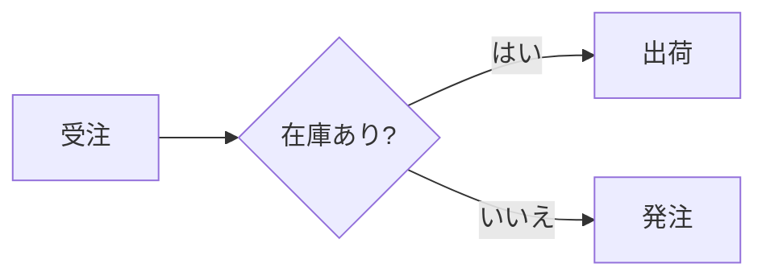

# Mermaid 変換

Mermaid の図は、エンジンが自前でベクター描画します。ブラウザ、Puppeteer、Mermaid 本体の JavaScript は要りません。次の 3 つの使い方があります。

| 使い方 | 入口 | 向いている用途 |
| :--- | :--- | :--- |
| Markdown の ` ```mermaid ` | `wasm-html-to-image/markdown` | 文書の中に図を書く。PDF にもそのまま入る |
| HTML の `<pre class="mermaid">` / `<div class="mermaid">` | `render()` | HTML ページの中に図を置く |
| 図だけを取り出す | `renderMermaid()` | SVG 文字列や PNG などの画像として図を得る |

どの使い方でも、描画するエンジンと対応する図種は同じです。文字の幅は実際のフォントで測るため、日本語のラベルも正確に収まります。

---

## 1. 使い方

### Markdown の中に書く

````markdown

````

PDF では、図がページをまたいで分断されず、文字は選択できるベクターのままです。`mermaid: false` を渡すと、通常のコードブロックとして表示します。詳しくは [Markdown 変換](./markdown.md#mermaid-図) を参照してください。

### HTML の中に置く

```html
<div class="mermaid">
  sequenceDiagram
    A->>B: こんにちは
</div>
```

`<pre class="mermaid">` でも同じです。要素の文字列が図のソースになります。色はページの CSS から決まります（[CSS からの指定](#3-css-からの指定)）。

### コマンドラインから

`.mmd` / `.mermaid` ファイルを渡すと、図の大きさに合わせた画像（または SVG、PDF）になります。出力の形式は `-o` の拡張子で決まります。

```bash
npx wasm-html-to-image flow.mmd -o flow.svg
npx wasm-html-to-image flow.mmd -o flow.png --mermaid-theme nord
npx wasm-html-to-image "graph LR; A-->B" --mermaid -o ab.png          # インラインの文字列
cat flow.mmd | npx wasm-html-to-image - --mermaid -o flow.webp --mermaid-mode recover
```

`-w` を付けたときだけ、画像の幅が決まります。`--accent` で矢印の色、`--mermaid-directives` で本文の `%%{init}%%` を反映できます。

### 図だけを取り出す（`renderMermaid`）

```typescript
import { renderMermaid } from "wasm-html-to-image/single";

const { data: svg } = await renderMermaid("graph LR\n  A --> B"); // SVG 文字列
const { data: png } = await renderMermaid("graph LR\n  A --> B", {
  format: "png",
  theme: "dark",
});
```

図の大きさに合わせて、出力のサイズが自動で決まります（余白の分だけ広がります）。`format` が `"svg"` のときだけ文字列で、それ以外は `Uint8Array` です。

| 入口 | `renderMermaid` |
| :--- | :--- |
| `wasm-html-to-image/single`（Node.js などでは `wasm-html-to-image` も） | あり |
| `wasm-html-to-image/workers` | あり（ワーカープールで描画） |
| `/workerd`（Cloudflare Workers では `wasm-html-to-image` もこちらに解決される） | あり（同梱の WASM に結びついている） |
| `/edge-light` | `bindRenderMermaid((options) => render(options, wasm))` で作る。`renderMermaidWith((options) => render(options, wasm), source, options)` も使える |

HTML ページとして使いたいときは、`mermaidToHtml(source, options)` が、図を 1 つ含む HTML 文字列を返します。

---

## 2. オプション（`renderMermaid` / `mermaidToHtml`）

| オプション | 既定値 | 説明 |
| :--- | :--- | :--- |
| `format` | `"svg"` | 出力形式: `svg`、`png`、`webp`、`jpeg`、`avif`、`jxl`、`pdf` など |
| `theme` | `"light"` | 配色（[テーマ](#4-テーマ)）。`MERMAID_THEMES` のキー |
| `accent` | テーマの値 | 矢印やバーの色（CSS の色） |
| `padding` | `16` | 図の周りの余白（px） |
| `width` | 図の幅 + 余白 | 画像の幅（px） |
| `background` | SVG は透明、画像はテーマの背景色 | ページの背景（CSS の色、または `"transparent"`） |
| `mode` | `"strict"` | 誤りの許容度（[入力の補正](#5-入力の補正)） |
| `directives` | `false` | 本文の `%%{init: {...}}%%` と frontmatter の `config:` を反映する |
| `maxLines` | `2000` | 図のテキストの行数の上限（コメントと空行は数えない）。`0` で無制限 |
| `maxSourceBytes` | `200000` | 図のソースの大きさの上限（バイト）。`0` で無制限 |
| `onWarning` | なし | `(warning) => void`。図が読めなかったとき（`MERMAID_ERROR`）と、入力の補正で直した内容（`MERMAID_RECOVERED`、1 件ずつ）を受け取る |

---

## 3. CSS からの指定

`<div class="mermaid">` や Markdown の図は、その要素（または祖先）の CSS カスタムプロパティから、色と動作を決めます。

| プロパティ | 内容 |
| :--- | :--- |
| `color` | 文字色（`--mermaid-fg` が無いとき） |
| `--mermaid-theme` | 名前付きテーマ（例: `nord`）。以下の個別の色は、その上に重なります |
| `--mermaid-fg` / `--mermaid-bg` | 文字色 / 背景色。ほかの色は、この 2 色から計算されます |
| `--mermaid-accent` | 矢印やバーの色 |
| `--mermaid-line` | 線の色 |
| `--mermaid-muted` | 補助の文字（辺のラベルなど） |
| `--mermaid-surface` | ノードの塗り |
| `--mermaid-border` | ノードの枠線 |
| `--mermaid-arrow` | 矢じりの色（既定は `--mermaid-accent`。公式の配色のテーマでは線の色） |
| `--mermaid-group-fill` / `--mermaid-group-header` | サブグラフの本体 / 見出しの帯 |
| `--mermaid-label-fill` | 辺のラベルの背景 |
| `--mermaid-mode` | `compat` または `recover` |
| `--mermaid-directives` | `on` で `%%{init}%%` と frontmatter を反映 |

```html
<style>
  .mermaid { --mermaid-theme: dracula; --mermaid-accent: #ff79c6; }
</style>
```

---

## 4. テーマ

| 名前 | 文字 | 背景 | 備考 |
| :--- | :--- | :--- | :--- |
| `light`（既定） | `#333333` | `#ffffff` | 公式 Mermaid の `default` の配色 |
| `dark` | `#cccccc` | `#333333` | 公式の `dark` の配色 |
| `neutral` | `#000000` | `#ffffff` | 公式の `neutral` の配色 |
| `forest` | `#000000` | `#ffffff` | 公式の `forest` の配色 |
| `nord` | `#eceff4` | `#2e3440` | |
| `dracula` | `#f8f8f2` | `#282a36` | |
| `solarized-light` | `#586e75` | `#fdf6e3` | |
| `solarized-dark` | `#93a1a1` | `#002b36` | |
| `rose-pine` | `#e0def4` | `#191724` | |
| `sepia` | `#433422` | `#f4ecd8` | |

`light`、`dark`、`neutral`、`forest` は、公式 Mermaid 12 の `default`、`dark`、`neutral`、`forest` が描く色に合わせています（ノードの塗りと枠、線、矢じり、サブグラフ）。`nord` 以降はこのエンジン独自の配色です。

`%%{init: {"theme": "dark"}}%%` の `theme` にも同じ名前が使えます（`default` と `base` は `light`）。`themeVariables` の `primaryColor`、`primaryBorderColor`、`lineColor`、`arrowheadColor`、`clusterBkg`、`textColor`、`background`、`secondaryTextColor` は、テーマの上に重なります。ただし、ディレクティブは `directives: true`（または `--mermaid-directives: on`）のときだけ反映されます。ページの配色は、書き手ではなく、図を置く側が決めるためです。

---

## 5. 入力の補正

壊れたソースをどこまで許すかを、`mode` で選びます。

| モード | 許すもの |
| :--- | :--- |
| `strict`（既定） | なし。誤りはエラー枠で表示します。図種名の綴りが近いときは、`flowchart のことですか?` と候補を添えます |
| `compat` | 図種名の大文字小文字、先頭の BOM、CRLF、閉じ忘れた `end` / `}`（最大 3 つ） |
| `recover` | `compat` に加えて、図種名の綴り違い（編集距離 1〜2 で候補が 1 つに決まるとき）と、読めない行の読み飛ばし |

直した内容は、`onWarning` で 1 件ずつ受け取れます（`MERMAID_RECOVERED`）。読めなかった図は `MERMAID_ERROR` で届きます。

```typescript
await renderMermaid("flowchrt LR\n  A --> B", {
  mode: "recover",
  onWarning: (w) => console.warn(w.code, w.message), // MERMAID_RECOVERED: `flowchrt` read as `flowchart`
});
```

CLI では、同じ内容が標準エラー出力に出ます。図が読めなかったときは、エラー枠の入った画像を書き出したうえで、終了コード 1 で終わります（スクリプトや CI で失敗に気づけます）。

---

## 6. 対応している図

| 図 | 書き出し |
| :--- | :--- |
| フローチャート | `graph` / `flowchart` |
| シーケンス図 | `sequenceDiagram` |
| 状態遷移図 | `stateDiagram-v2` |
| クラス図 | `classDiagram` |
| ER 図 | `erDiagram` |
| 要求図 | `requirementDiagram` |
| ブロック図 | `block-beta`（`block:id ... end` の入れ子に対応） |
| C4 図 | `C4Context` / `C4Container` / `C4Component` / `C4Dynamic` / `C4Deployment` |
| アーキテクチャ図 | `architecture-beta` |
| ガントチャート | `gantt` |
| 円グラフ | `pie` |
| 棒・折れ線グラフ | `xychart-beta` |
| 四象限チャート | `quadrantChart` |
| レーダーチャート | `radar-beta` |
| サンキー図 | `sankey-beta` |
| ツリーマップ | `treemap-beta` |
| ベン図 | `venn-beta` |
| マインドマップ | `mindmap` |
| タイムライン | `timeline` |
| ユーザージャーニー | `journey` |
| Git グラフ | `gitGraph` |
| カンバン | `kanban` |
| パケット図 | `packet-beta` |
| 特性要因図（フィッシュボーン） | `ishikawa-beta` |
| ツリー表示 | `treeView-beta` |
| ウォードリーマップ | `wardley-beta` |
| クネヴィンフレームワーク | `cynefin-beta` |
| 構文図（鉄道図） | `railroad-ebnf-beta` `railroad-abnf-beta` `railroad-peg-beta` `railroad-beta` |
| イベントモデリング | `eventmodeling` |
| ユースケース図 | `usecase-beta` |
| スイムレーン図 | `swimlane-beta` |
| エージェントフロー図 | `agentflow-beta` |
| バージョン表示 | `info` |

未対応の図種（`zenuml` など）は、図の位置にエラー枠が表示されます。

:::note
`-beta` の付く図の記法は、Mermaid 本体でも変わりやすい部分です。`venn-beta`、`ishikawa-beta`、`treeView-beta`、`treemap-beta`、`radar-beta`、`architecture-beta` は、本体の最新の記法と細部が違うことがあります。違いに気づいたら、`recover` モードで読み飛ばされた行を手がかりに、Issue で教えてください。
:::

### 共通の記法

- **スタイル**: `classDef`、`class`、`:::`、`style` は、フローチャート、状態遷移図、クラス図（`cssClass` を使う）、ER 図、ブロック図で使えます。`linkStyle` はフローチャートだけです。
- **アクセシビリティ**: `accTitle: 題名` と `accDescr: 説明`（複数行は `accDescr { ... }`）は、図には描かず、SVG の `<title>` と `<desc>` として出力します。
- **frontmatter**: 先頭の `---` で囲んだ部分は読み飛ばします。`directives` を有効にすると、`config:` の `theme` と `themeVariables` を反映します。
- **コメント**: `%%` で始まる行は無視します。

### 新しい図の書き方（例）

次の 7 種は、公式 Mermaid 12.2 の公式ドキュメントにある記法を通すことを優先して実装しています。どれも `-beta` か新しい図で、記法は変わりやすい部分です。

| 図 | 描かれるもの | 補足 |
| :--- | :--- | :--- |
| `wardley-beta` | 進化（横）と可視性（縦）の座標に置いた部品、アンカー、リンク、進化の矢印、パイプライン、注釈 | 追跡の矢印 `-.- (x,y)` は描きません |
| `cynefin-beta` | 5 つの領域（複雑・煩雑・明確・混乱・混沌）、波打つ境界、崖、項目のバッジ、領域間の遷移の矢印 | 領域の色は公式のテーマの値です |
| `railroad-*` | EBNF / ABNF / PEG / 公式の中間表現の 4 つの方言を、同じ構文図にして描きます | 配置は近似です |
| `eventmodeling` | 時間枠、UI・コマンド・イベントなどの 3 つのレーン、データブロック、明示と推論の関連 | 公式 12.2.0 の npm パッケージには描画器がありません |
| `usecase-beta` | アクター、ユースケース、システム境界、関連、include・extend・汎化、注、JSON の表、スタイル | `icon` と `colorScheme: rotate` は読み飛ばします |
| `swimlane-beta` | フローチャートの記法のまま、最上位の `subgraph` を帯（レーン）にして配置します | 辺の `curve` などは読み飛ばします |
| `agentflow-beta` | `flow` を `subgraph` に、`global` を枠なしのグループに読み替えて、フローチャートとして描きます | `@{ shape: ... }` で形を選びます。公式 12.2.0 のパッケージには描画器がありません |

```
wardley-beta
title Tea Shop
anchor Business [0.95, 0.63]
component Cup of Tea [0.79, 0.61]
component Kettle [0.43, 0.35]
Business -> Cup of Tea
Cup of Tea -> Kettle
```

```
cynefin-beta
title Incident triage
complex
  "Experiment"
complicated
  "Analyse"
clear
  "Follow the runbook"
chaotic
  "Stabilise"
```

```
railroad-ebnf-beta
expr = term , { ( "+" | "-" ) , term } ;
term = factor , { ( "*" | "/" ) , factor } ;
factor = number | "(" , expr , ")" ;
```

```
eventmodeling
tf 01 ui CartUI
tf 02 cmd AddItem [[AddItem01]]
tf 03 evt ItemAdded [[ItemAdded]]
data AddItem01 {
  price: 20.4
}
```

```
usecase-beta
  actor Admin
  actor Person
  Checkout
  Payment
  ApplyCoupon
  Admin --|> Person
  Person --> Checkout
  Checkout ..> : include Payment
  ApplyCoupon ..> : extend Checkout
```

```
swimlane-beta LR
  subgraph Customer
    request[Request service]
  end
  subgraph Support
    triage[Triage request]
    answer[Send answer]
  end
  request --> triage
  triage -->|Known issue| answer
```

```
agentflow-beta TB
  flow reviewer["Review Agent"]
    changes["Gather changes"]@{ shape: input }
    lint["run_linter"]@{ shape: tool }
    ok["Clean?"]@{ shape: decision }
    changes --> lint --> ok
  end
```

---

## 7. 大きさの上限

大きなグラフの配置は、大きさよりも速く重くなります（実測で、フローチャートは 600 ノードで数秒、1500 ノードで数分かかります）。利用者の入力をそのまま描くサーバーが、巨大な図で止まらないように、行数（既定 2000）とソースの大きさ（既定 200000 バイト）に上限があります。超えた図は、エラー枠（`MERMAID_ERROR`）になります。必要なら `maxLines` / `maxSourceBytes`（CSS では `--mermaid-max-lines` / `--mermaid-max-bytes`）で変えられます。

## 8. エラーの扱い

構文エラーや未対応の図は、図の位置に 1 行のエラー枠（`Mermaid: ...`）を表示します。文書全体の変換は止まりません。`renderMermaid()` でも同じ枠の SVG が返ります。

## 9. プレイグラウンドで試す

プレイグラウンドの「Mermaid」タブで、図種ごとのサンプル（全 33 種）、テーマ、入力の補正、出力形式（SVG / PNG / WebP / JPEG / AVIF / JXL / PDF）、アクセント色、ディレクティブを、その場で切り替えられます。「Gallery」では、全サンプルを今の設定で一覧できます。設定は URL に残ります。図のソースも（圧縮して、約 6000 文字まで）`src=` として URL に入るので、リンク 1 本で図ごと共有できます（例: `?mode=mermaid&theme=nord&format=png&view=gallery`）。

---

## 10. 実行環境

| 環境 | `renderMermaid` の入手 |
| :--- | :--- |
| Node.js、Bun、Deno | `wasm-html-to-image` または `/single`。Deno と Bun では、Markdown の取り込みと `javascript` オプションに制限があります（[互換性](../compatibility.md)） |
| Cloudflare Workers（workerd） | `wasm-html-to-image/workerd` が、同梱の WASM に結びついた `renderMermaid` を直接出します。`wasm-html-to-image` もここに解決されます |
| Vercel Edge など（edge-light） | `bindRenderMermaid((options) => render(options, wasm))` で作ります。`renderMermaidWith` と `mermaidToHtml` も同じ入口にあります |

図は Skia の SVG でそのまま描くので、DOM は要りません。workerd では、`packages/e2e-cloudflare` の煙テスト（`/mermaid`）で、PNG になるところまで確かめています。edge-light は型と出力のテストまでで、実際のランタイムでは動かしていません。

---

## 11. 公式 Mermaid との比較

- **色**: `light`、`dark`、`neutral`、`forest` は、公式 12.2 の描く色（計算値）に合わせています。`packages/mermaid-compare` の `parity.html` は、同じ図を両方で描いて、ノードの塗り、枠、線、文字の色の差（CIE76 の ΔE）を一覧にします。新しい図は、wardley、cynefin、railroad の塗りと線が ΔE 0〜1.4 で、公式とほぼ同じです。文字は 0〜9.7、usecase の枠は 3.6〜11.9 です。測定の方法と結果は、リポジトリの `doc/design/mermaid-theme-parity.md` と `doc/design/mermaid-new-diagrams.md` にあります。
- **形**: 配置の計算はエンジン独自です。公式と同じ座標にはなりません。ノードの位置や線の曲がり方は、図ごとに近いだけです。
- **未対応**: `zenuml` だけです。公式の `elk` レイアウトは使わず、`flowchart-elk` も同じ配置で描きます。
- **ブラウザ向けの機能**: クリックのイベントとリンクの `click` は、画像や PDF では意味がないので、無視します。

比較アプリは `pnpm --filter mermaid-compare dev` で動きます（`http://localhost:3001`）。左右並べ、スライダー、SVG・PNG・WebP の書き出しで、公式の描画と見比べられます。
