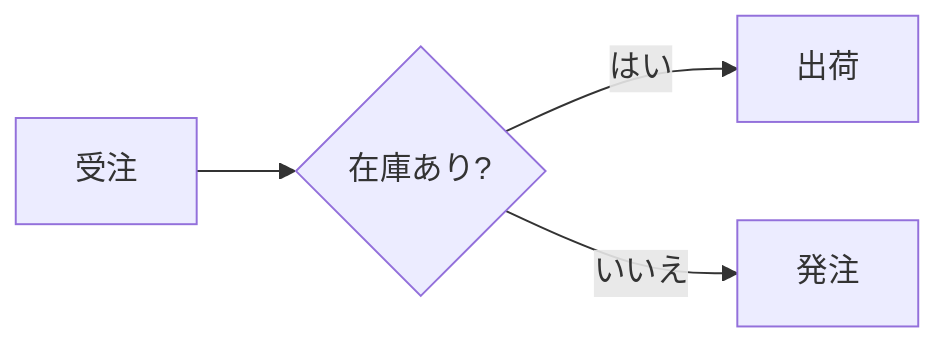

# Mermaid 変換

Mermaid の図は、エンジンが自前でベクター描画します。ブラウザ、Puppeteer、Mermaid 本体の JavaScript は要りません。次の 3 つの使い方があります。

| 使い方 | 入口 | 向いている用途 |
| :--- | :--- | :--- |
| Markdown の ` ```mermaid ` | `wasm-html-to-image/markdown` | 文書の中に図を書く。PDF にもそのまま入る |
| HTML の `<pre class="mermaid">` / `<div class="mermaid">` | `render()` | HTML ページの中に図を置く |
| 図だけを取り出す | `renderMermaid()` | SVG 文字列や PNG などの画像として図を得る |

どの使い方でも、描画するエンジンと対応する図種は同じです。文字の幅は実際のフォントで測るため、日本語のラベルも正確に収まります。

---

## 1. 使い方

### Markdown の中に書く

````markdown

````

PDF では、図がページをまたいで分断されず、文字は選択できるベクターのままです。`mermaid: false` を渡すと、通常のコードブロックとして表示します。詳しくは [Markdown 変換](./markdown.md#mermaid-図) を参照してください。

### HTML の中に置く

```html
<div class="mermaid">
  sequenceDiagram
    A->>B: こんにちは
</div>
```

`<pre class="mermaid">` でも同じです。要素の文字列が図のソースになります。色はページの CSS から決まります（[CSS からの指定](#3-css-からの指定)）。

### コマンドラインから

`.mmd` / `.mermaid` ファイルを渡すと、図の大きさに合わせた画像（または SVG、PDF）になります。出力の形式は `-o` の拡張子で決まります。

```bash
npx wasm-html-to-image flow.mmd -o flow.svg
npx wasm-html-to-image flow.mmd -o flow.png --mermaid-theme nord
npx wasm-html-to-image "graph LR; A-->B" --mermaid -o ab.png          # インラインの文字列
cat flow.mmd | npx wasm-html-to-image - --mermaid -o flow.webp --mermaid-mode recover
```

`-w` を付けたときだけ、画像の幅が決まります。`--accent` で矢印の色、`--mermaid-directives` で本文の `%%{init}%%` を反映できます。

### 図だけを取り出す（`renderMermaid`）

```typescript
import { renderMermaid } from "wasm-html-to-image/single";

const { data: svg } = await renderMermaid("graph LR\n  A --> B"); // SVG 文字列
const { data: png } = await renderMermaid("graph LR\n  A --> B", {
  format: "png",
  theme: "dark",
});
```

図の大きさに合わせて、出力のサイズが自動で決まります（余白の分だけ広がります）。`format` が `"svg"` のときだけ文字列で、それ以外は `Uint8Array` です。

| 入口 | `renderMermaid` |
| :--- | :--- |
| `wasm-html-to-image/single`（Node.js などでは `wasm-html-to-image` も） | あり |
| `wasm-html-to-image/workers` | あり（ワーカープールで描画） |
| `/workerd`、`/edge-light`（Cloudflare Workers では `wasm-html-to-image` もこちらに解決される） | `renderMermaid` は無い。`renderMermaidWith((options) => render(options, wasm), source, options)` を使う |

HTML ページとして使いたいときは、`mermaidToHtml(source, options)` が、図を 1 つ含む HTML 文字列を返します。

---

## 2. オプション（`renderMermaid` / `mermaidToHtml`）

| オプション | 既定値 | 説明 |
| :--- | :--- | :--- |
| `format` | `"svg"` | 出力形式: `svg`、`png`、`webp`、`jpeg`、`avif`、`jxl`、`pdf` など |
| `theme` | `"light"` | 配色（[テーマ](#4-テーマ)）。`MERMAID_THEMES` のキー |
| `accent` | テーマの値 | 矢印やバーの色（CSS の色） |
| `padding` | `16` | 図の周りの余白（px） |
| `width` | 図の幅 + 余白 | 画像の幅（px） |
| `background` | SVG は透明、画像はテーマの背景色 | ページの背景（CSS の色、または `"transparent"`） |
| `mode` | `"strict"` | 誤りの許容度（[入力の補正](#5-入力の補正)） |
| `directives` | `false` | 本文の `%%{init: {...}}%%` と frontmatter の `config:` を反映する |
| `maxLines` | `2000` | 図のテキストの行数の上限（コメントと空行は数えない）。`0` で無制限 |
| `maxSourceBytes` | `200000` | 図のソースの大きさの上限（バイト）。`0` で無制限 |
| `onWarning` | なし | `(warning) => void`。図が読めなかったとき（`MERMAID_ERROR`）と、入力の補正で直した内容（`MERMAID_RECOVERED`、1 件ずつ）を受け取る |

---

## 3. CSS からの指定

`<div class="mermaid">` や Markdown の図は、その要素（または祖先）の CSS カスタムプロパティから、色と動作を決めます。

| プロパティ | 内容 |
| :--- | :--- |
| `color` | 文字色（`--mermaid-fg` が無いとき） |
| `--mermaid-theme` | 名前付きテーマ（例: `nord`）。以下の個別の色は、その上に重なります |
| `--mermaid-fg` / `--mermaid-bg` | 文字色 / 背景色。ほかの色は、この 2 色から計算されます |
| `--mermaid-accent` | 矢印やバーの色 |
| `--mermaid-line` | 線の色 |
| `--mermaid-muted` | 補助の文字（辺のラベルなど） |
| `--mermaid-surface` | ノードの塗り |
| `--mermaid-border` | ノードの枠線 |
| `--mermaid-mode` | `compat` または `recover` |
| `--mermaid-directives` | `on` で `%%{init}%%` と frontmatter を反映 |

```html
<style>
  .mermaid { --mermaid-theme: dracula; --mermaid-accent: #ff79c6; }
</style>
```

---

## 4. テーマ

| 名前 | 文字 | 背景 | 備考 |
| :--- | :--- | :--- | :--- |
| `light`（既定） | `#1f2328` | `#ffffff` | |
| `dark` | `#e6edf3` | `#0d1117` | |
| `neutral` | `#222222` | `#ffffff` | 灰色が中心 |
| `forest` | `#1b3a2a` | `#ffffff` | 緑のアクセント |
| `nord` | `#eceff4` | `#2e3440` | |
| `dracula` | `#f8f8f2` | `#282a36` | |
| `solarized-light` | `#586e75` | `#fdf6e3` | |
| `solarized-dark` | `#93a1a1` | `#002b36` | |
| `rose-pine` | `#e0def4` | `#191724` | |
| `sepia` | `#433422` | `#f4ecd8` | |

`%%{init: {"theme": "dark"}}%%` の `theme` にも同じ名前が使えます（`default` と `base` は `light`）。`themeVariables` の `primaryColor`、`primaryBorderColor`、`lineColor`、`textColor`、`background`、`secondaryTextColor` は、テーマの上に重なります。ただし、ディレクティブは `directives: true`（または `--mermaid-directives: on`）のときだけ反映されます。ページの配色は、書き手ではなく、図を置く側が決めるためです。

---

## 5. 入力の補正

壊れたソースをどこまで許すかを、`mode` で選びます。

| モード | 許すもの |
| :--- | :--- |
| `strict`（既定） | なし。誤りはエラー枠で表示します。図種名の綴りが近いときは、`flowchart のことですか?` と候補を添えます |
| `compat` | 図種名の大文字小文字、先頭の BOM、CRLF、閉じ忘れた `end` / `}`（最大 3 つ） |
| `recover` | `compat` に加えて、図種名の綴り違い（編集距離 1〜2 で候補が 1 つに決まるとき）と、読めない行の読み飛ばし |

直した内容は、`onWarning` で 1 件ずつ受け取れます（`MERMAID_RECOVERED`）。読めなかった図は `MERMAID_ERROR` で届きます。

```typescript
await renderMermaid("flowchrt LR\n  A --> B", {
  mode: "recover",
  onWarning: (w) => console.warn(w.code, w.message), // MERMAID_RECOVERED: `flowchrt` read as `flowchart`
});
```

CLI では、同じ内容が標準エラー出力に出ます。図が読めなかったときは、エラー枠の入った画像を書き出したうえで、終了コード 1 で終わります（スクリプトや CI で失敗に気づけます）。

---

## 6. 対応している図

| 図 | 書き出し |
| :--- | :--- |
| フローチャート | `graph` / `flowchart` |
| シーケンス図 | `sequenceDiagram` |
| 状態遷移図 | `stateDiagram-v2` |
| クラス図 | `classDiagram` |
| ER 図 | `erDiagram` |
| 要求図 | `requirementDiagram` |
| ブロック図 | `block-beta`（入れ子のブロックは未対応） |
| C4 図 | `C4Context` / `C4Container` / `C4Component` / `C4Dynamic` / `C4Deployment` |
| アーキテクチャ図 | `architecture-beta` |
| ガントチャート | `gantt` |
| 円グラフ | `pie` |
| 棒・折れ線グラフ | `xychart-beta` |
| 四象限チャート | `quadrantChart` |
| レーダーチャート | `radar-beta` |
| サンキー図 | `sankey-beta` |
| ツリーマップ | `treemap-beta` |
| ベン図 | `venn-beta` |
| マインドマップ | `mindmap` |
| タイムライン | `timeline` |
| ユーザージャーニー | `journey` |
| Git グラフ | `gitGraph` |
| カンバン | `kanban` |
| パケット図 | `packet-beta` |
| 特性要因図（フィッシュボーン） | `ishikawa-beta` |
| ツリー表示 | `treeView-beta` |
| バージョン表示 | `info` |

未対応の図種（`zenuml`、`wardley-beta`、`eventmodeling` など）は、図の位置にエラー枠が表示されます。

:::note
`-beta` の付く図の記法は、Mermaid 本体でも変わりやすい部分です。`venn-beta`、`ishikawa-beta`、`treeView-beta`、`treemap-beta`、`radar-beta`、`architecture-beta` は、本体の最新の記法と細部が違うことがあります。違いに気づいたら、`recover` モードで読み飛ばされた行を手がかりに、Issue で教えてください。
:::

### 共通の記法

- **スタイル**: `classDef`、`class`、`:::`、`style` は、フローチャート、状態遷移図、クラス図（`cssClass` を使う）、ER 図、ブロック図で使えます。`linkStyle` はフローチャートだけです。
- **アクセシビリティ**: `accTitle: 題名` と `accDescr: 説明`（複数行は `accDescr { ... }`）は、図には描かず、SVG の `<title>` と `<desc>` として出力します。
- **frontmatter**: 先頭の `---` で囲んだ部分は読み飛ばします。`directives` を有効にすると、`config:` の `theme` と `themeVariables` を反映します。
- **コメント**: `%%` で始まる行は無視します。

---

## 7. 大きさの上限

大きなグラフの配置は、大きさよりも速く重くなります（実測で、フローチャートは 600 ノードで数秒、1500 ノードで数分かかります）。利用者の入力をそのまま描くサーバーが、巨大な図で止まらないように、行数（既定 2000）とソースの大きさ（既定 200000 バイト）に上限があります。超えた図は、エラー枠（`MERMAID_ERROR`）になります。必要なら `maxLines` / `maxSourceBytes`（CSS では `--mermaid-max-lines` / `--mermaid-max-bytes`）で変えられます。

## 8. エラーの扱い

構文エラーや未対応の図は、図の位置に 1 行のエラー枠（`Mermaid: ...`）を表示します。文書全体の変換は止まりません。`renderMermaid()` でも同じ枠の SVG が返ります。

## 9. プレイグラウンドで試す

プレイグラウンドの「Mermaid」タブで、図種ごとのサンプル（全 26 種）、テーマ、入力の補正、出力形式（SVG / PNG / WebP / JPEG / AVIF / JXL / PDF）、アクセント色、ディレクティブを、その場で切り替えられます。「Gallery」では、全サンプルを今の設定で一覧できます。設定は URL に残ります。図のソースも（圧縮して、約 6000 文字まで）`src=` として URL に入るので、リンク 1 本で図ごと共有できます（例: `?mode=mermaid&theme=nord&format=png&view=gallery`）。
