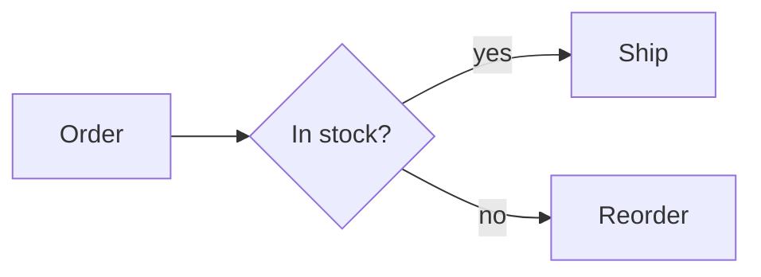

# Markdown Conversion (`/markdown`)

`wasm-html-to-image/markdown` converts GitHub-flavoured Markdown (GFM) into beautifully styled HTML pages and multi-page PDF documents.

It is implemented in pure JavaScript with no Node.js platform dependencies, running seamlessly across Node.js, modern browsers, and edge runtimes like Cloudflare Workers.

---

## Key Capabilities

- **`markdownToDocument()` & `markdownToHtml()`**: Produce HTML and complete PDF render options (headers, footers, metadata).
- **Template System**: 11 built-in templates (`default`, `report`, `proposal`, `book`, `paper`, `compact`, `manual`, `minutes`, `letter`, `slides`, `invoice`) for ready-to-use professional styling without writing CSS.
- **Automatic Table of Contents (TOC)**: Generates a table of contents with exact destination page numbers filled in during PDF pagination.
- **Automatic PDF Bookmarks (Outline)**: Creates nested PDF document outlines from `h1`–`h6` headings.
- **Smart Page Break Handling**: Avoids orphan headings (`break-after: avoid`) and prevents breaking code blocks and tables across page boundaries.
- **YAML Front Matter**: Parses document metadata (`title`, `subtitle`, `author`, `date`, `template`, `stamp`, `cover`, `accent`, etc.).
- **Syntax Highlighting**: Built-in highlight.js covering 20+ programming languages.
- **Mermaid diagrams**: ` ```mermaid ` blocks (flowchart, sequence, state, class, ER, bar/line chart) are drawn inside the engine.
- **KaTeX Mathematical Typesetting (`/markdown-math`)**: High-accuracy rendering for inline `$…$` and display `$$…$$` equations.

---

## Basic Usage

### 1. Generating a PDF from Markdown

Use `markdownToDocument()` to retrieve both the document HTML and the required PDF options (such as running headers and footers), then pass them to `render()`:

```typescript
import fs from "node:fs/promises";
import { render } from "wasm-html-to-image";
import { markdownToDocument } from "wasm-html-to-image/markdown";

const md = `---
title: Quarterly Performance Report
subtitle: Q3 2026
author: Taro Yamada
date: 2026-10-29
template: report
accent: "#2563eb"
stamp: CONFIDENTIAL
---

# Executive Summary

Revenue increased by **+15.2%** year-over-year.

# Key Performance Indicators

| KPI | Target | Actual |
| :--- | :--- | :--- |
| Gross Margin | $5.0M | $5.4M |
| New Customers | 120 | 135 |
`;

// Retrieve HTML and PDF layout options
const { html, renderOptions } = markdownToDocument(md, {
  paged: true, // Enable page margins and pagination optimization
});

const { data } = await render({
  value: html,
  format: "pdf",
  ...renderOptions,
});

await fs.writeFile("report.pdf", Buffer.from(data));
```

### 2. Rendering as a Single Image (PNG / WebP)

Use `markdownToHtml()` when rendering standalone images:

```typescript
import { render } from "wasm-html-to-image";
import { markdownToHtml } from "wasm-html-to-image/markdown";

const html = markdownToHtml("# Document Title\n\nContent...", {
  theme: "dark",
  maxWidth: 800,
});

const { data } = await render({
  value: html,
  width: 900,
  format: "png",
});
```

---

## Built-in Templates

Templates configure the document's typography, page size, margins, running headers/footers, and cover/contents pages. All templates support both light and dark themes.

| Template | Intended Use | Layout & Features |
| :--- | :--- | :--- |
| `default` | Web images, quick PDFs | Clean GitHub-like style |
| `report` | Business reports, specs | A4, cover page, table of contents, accent colour, title in header, author and `n / N` in footer |
| `proposal` | Proposals, quotations | A4, cover, accent bars on sections, tinted table headers, call-out quotes, title and `n / N` in the footer |
| `book` | Books, long-form reading | A5, serif, justified text, each chapter (`h1`) starts on a new page, cover, TOC, page numbers |
| `paper` | Technical papers, essays | A4, serif, justified text, tight line-height, page number in footer |
| `compact` | Notes, cheat sheets | 12px font, 12mm margins, no cover or TOC |
| `manual` | Manuals, specifications | A4, cover, contents, numbered headings, each chapter (`h1`) on a new page, call-outs, title in the header and page number in the footer |
| `minutes` | Meeting minutes | A4, no cover or contents, ruled title, tinted table headers, title and date in the header |
| `letter` | Letters, notices | A4, serif, wide margins, generous leading, `.right` and `.center` classes for the address block and date |
| `slides` | Presentations | A4 landscape, 28px text, each `h2` on its own page, `---` ignored, with a cover |
| `invoice` | Invoices, quotations | A4, large right-aligned title, accent table header, emphasised last row, call-out box for notes |

Inspect available templates with `listTemplates()`:

```typescript
import { listTemplates } from "wasm-html-to-image/markdown";

console.log(listTemplates());
```

---

## YAML Front Matter

Place front matter at the top of the file enclosed by `---`:

```markdown
---
title: System Architecture Spec<br>v2.0
subtitle: Next-generation Graphics Pipeline
author: Core Engineering Team
date: 2026-10-29
template: report
accent: "#059669"
font: sans-serif
page_size: A4
stamp: DRAFT
cover: true
toc: true
logo: https://example.com/logo.png
lang: en
---
```

### Precedence Order

Settings are resolved in the following order:
1. Template defaults (`template.defaults`)
2. Front matter attributes
3. API options (`options.settings`, `options.title`, etc.)

---

### Page and cover settings

These front matter keys also change the page:

| Key | Value | Effect |
| :--- | :--- | :--- |
| `header` / `footer` | HTML | Running header and footer (replacing the template's). `{{title}}`, `{{author}}`, `{{date}}`, `{{stamp}}`, `{{pageNumber}}`, `{{totalPages}}` and `{{chapter}}` (the `h1` the page shows first, else the chapter before it) work. The `book` header shows the chapter |
| `margin` | `20mm 18mm` | Page margin (a CSS `margin` value) |
| `orientation` | `landscape` | Turn the paper sideways |
| `toc_depth` | `1` to `6` | Deepest heading level in the contents |
| `toc_title` | text | Heading of the contents page (`Contents`) |
| `cover_style` | `band` / `plain` / `center` | Look of the cover |
| `numbering` | `true` | Number the headings `1`, `1.1`, `1.1.1` |
| `mermaid_theme` | a name (`nord`, ...) | Draw the diagrams with a named theme instead of the document's light / dark colours (pick one that suits the page: `dracula`, `nord` or `dark` on a dark document) |
| `mermaid_mode` | `compat` / `recover` | How much a broken diagram is forgiven |
| `mermaid_directives` | `true` | Honour `%%{init}%%` and frontmatter inside the diagrams |

With a template that has a cover, the cover carries no header or footer (page numbers still count it as page 1).

## Syntax extensions

- **Call-outs**: a block quote that starts with `[!NOTE]`, `[!TIP]`, `[!IMPORTANT]`, `[!WARNING]` or `[!CAUTION]` becomes a coloured box (the title is Japanese with `lang: ja`).
- **Numbered figures**: an image with a title, ``, becomes a figure captioned `Figure 1　Title`.
- **Page break**: `<!-- pagebreak -->` forces a new page.
- **Footnotes**: `[^name]` in the text and `[^name]: the note` anywhere put a list of notes at the end, numbered by first use.
- **Tables** span the text width in `report`, `proposal`, `book` and `paper`.
- **Long code lines** wrap at the right edge instead of being cut.

## Table of Contents & PDF Bookmarks

When `paged: true` (or CLI PDF output) is specified:

- **Contents Page**: Headings down to level 3 (by default) are indexed. Page numbers are dynamically linked to the layout output.
- **Bookmarks (Outline)**: Headings `h1`–`h6` automatically form the PDF reader outline tree.
- **In-page Links**: Links such as `[details](#setup)` work seamlessly inside the PDF.

```typescript
// Customise depth and heading
const { html, renderOptions } = markdownToDocument(md, {
  paged: true,
  toc: { depth: 2, title: "Contents" },
});

// Disable TOC page
const { html, renderOptions } = markdownToDocument(md, {
  paged: true,
  toc: false,
});

// Disable PDF bookmarks
await render({
  value: html,
  format: "pdf",
  pdfOutline: false,
  ...renderOptions,
});
```

---

## Mermaid diagrams

A ` ```mermaid ` code block is drawn by the engine itself as vector graphics: no browser or extra library, and in a PDF the text stays selectable.

````markdown

````

| Diagram | Starts with |
| :--- | :--- |
| Flowchart | `graph` / `flowchart` |
| Sequence | `sequenceDiagram` |
| State | `stateDiagram-v2` |
| Class | `classDiagram` |
| ER | `erDiagram` |
| Bar / line chart | `xychart-beta` |
| Pie chart | `pie` |
| Gantt chart | `gantt` |
| Mind map | `mindmap` |
| Timeline | `timeline` |
| User journey | `journey` |
| Quadrant chart | `quadrantChart` |
| Git graph | `gitGraph` |
| Kanban | `kanban` |
| Packet | `packet-beta` |
| Sankey | `sankey-beta` |
| Requirement | `requirementDiagram` |
| Block | `block-beta` (nested blocks are not supported) |
| C4 | `C4Context` / `C4Container` / `C4Component` / `C4Dynamic` / `C4Deployment` |
| Architecture | `architecture-beta` |
| Venn | `venn-beta` |
| Ishikawa (fishbone) | `ishikawa-beta` |
| Tree view | `treeView-beta` |
| Treemap | `treemap-beta` |
| Radar | `radar-beta` |
| Version banner | `info` |

- Colours follow the theme (`light` / `dark`).
- A diagram is never split across pages.
- `accTitle: Title` and `accDescr: Description` (`accDescr { ... }` for several lines) are not drawn; they become the SVG `<title>` and `<desc>`, which screen readers announce.
- Pass `mermaid: false` to show them as plain code blocks.
- An unsupported type (`architecture-beta`, `C4`, `zenuml`, ...) or a syntax error shows an error box where the diagram would be.

### Getting SVG or an image from JavaScript

`renderMermaid()` (a diagram alone as an SVG string or an image), themes, input repair and CSS control are described in [Mermaid Conversion](./mermaid.md).

## KaTeX Math Typesetting (`/markdown-math`)

Pass `katexMath()` from `wasm-html-to-image/markdown-math` to render inline `$…$` and display `$$…$$` TeX equations:

```typescript
import { render } from "wasm-html-to-image";
import { markdownToHtml } from "wasm-html-to-image/markdown";
import { katexMath } from "wasm-html-to-image/markdown-math";

const md = `
Euler's identity: $e^{i\\pi} + 1 = 0$

Quadratic formula:
$$
x = \\frac{-b \\pm \\sqrt{b^2 - 4ac}}{2a}
$$
`;

const html = markdownToHtml(md, {
  math: katexMath(), // Use { fontBase: "https://your-host/fonts" } to self-host KaTeX fonts
});
```

---

## Custom Templates

Define your own template using a JavaScript object or JSON file:

```typescript
const myTemplate = {
  type: {
    font: "serif",
    size: 14,
    lineHeight: 1.7,
    justify: true,
    chapterBreak: true,
  },
  page: {
    size: "B5",
    margin: "18mm",
    footer: `<div style="text-align:center;font-size:10px">{{pageNumber}} / {{totalPages}}</div>`,
  },
  defaults: {
    cover: true,
    toc: true,
    accent: "#0f766e",
  },
};

const doc = markdownToDocument(md, { template: myTemplate, paged: true });
```

### Build on a bundled template (`extends`)

Put the name of a bundled template in `extends` and override its `type`, `page` and `defaults` field by field; your `css` is appended after the base's. `defineTemplate()` only type-checks and returns the value unchanged.

```typescript
import { defineTemplate, markdownToDocument } from "wasm-html-to-image/markdown";

const mine = defineTemplate({
  extends: "report",
  type: { size: 13 },
  defaults: { accent: "#0f766e" },
  css: ".markdown-body h2 { border-bottom-style: dashed; }",
});

const doc = markdownToDocument(md, { template: mine, paged: true });
```

From the CLI, a JSON file such as `{ "extends": "report", "defaults": { "accent": "#0f766e" } }` works with `--template mine.json`.

### Write colours as CSS variables

In a template's `css`, use `var(--surface)`, `var(--border)`, `var(--muted)`, `var(--text)` and `var(--accent)` instead of fixed colours, so the template follows both the light and the dark theme.
