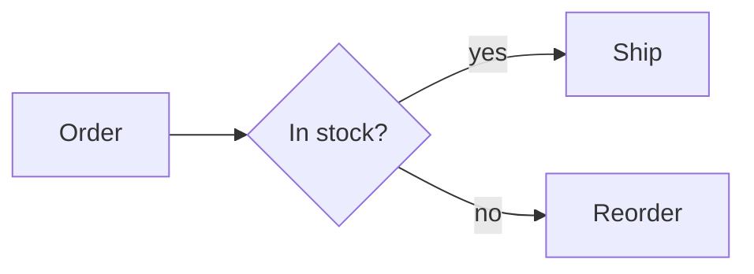

# Mermaid Conversion

The engine draws Mermaid diagrams itself, as vectors. No browser, Puppeteer or Mermaid JavaScript is needed. There are three ways to use it.

| Way | Entry | Good for |
| :--- | :--- | :--- |
| A ` ```mermaid ` fence in Markdown | `wasm-html-to-image/markdown` | Diagrams inside a document; they go into the PDF as they are |
| `<pre class="mermaid">` / `<div class="mermaid">` in HTML | `render()` | A diagram inside an HTML page |
| The diagram alone | `renderMermaid()` | An SVG string or a PNG (or other image) of one diagram |

All three use the same engine and the same diagram types. Text is measured with the real fonts, so Japanese labels fit exactly.

---

## 1. Usage

### Inside Markdown

````markdown

````

In a PDF a diagram is never split across pages, and its text stays selectable vector text. Pass `mermaid: false` to show it as an ordinary code block. See [Markdown Conversion](./markdown.md) for more.

### Inside HTML

```html
<div class="mermaid">
  sequenceDiagram
    A->>B: Hello
</div>
```

`<pre class="mermaid">` works the same. The element's text is the diagram source. Colours come from the page's CSS ([CSS control](#3-css-control)).

### From the command line

Give a `.mmd` / `.mermaid` file and the output is an image (or SVG, or PDF) sized to the diagram; the extension of `-o` picks the format.

```bash
npx wasm-html-to-image flow.mmd -o flow.svg
npx wasm-html-to-image flow.mmd -o flow.png --mermaid-theme nord
npx wasm-html-to-image "graph LR; A-->B" --mermaid -o ab.png          # inline text
cat flow.mmd | npx wasm-html-to-image - --mermaid -o flow.webp --mermaid-mode recover
```

The image width is fixed only when you pass `-w`. `--accent` sets the arrow colour and `--mermaid-directives` honours `%%{init}%%` in the source.

### The diagram alone (`renderMermaid`)

```typescript
import { renderMermaid } from "wasm-html-to-image/single";

const { data: svg } = await renderMermaid("graph LR\n  A --> B"); // an SVG string
const { data: png } = await renderMermaid("graph LR\n  A --> B", {
  format: "png",
  theme: "dark",
});
```

The output is sized to the diagram (plus the padding). `data` is a string for `format: "svg"` and a `Uint8Array` for everything else.

| Entry | `renderMermaid` |
| :--- | :--- |
| `wasm-html-to-image/single` (and `wasm-html-to-image` on Node.js and similar) | Yes |
| `wasm-html-to-image/workers` | Yes (drawn on the worker pool) |
| `/workerd` (on Cloudflare Workers `wasm-html-to-image` resolves here too) | Yes, bound to the bundled WASM |
| `/edge-light` | Build it with `bindRenderMermaid((options) => render(options, wasm))`; `renderMermaidWith((options) => render(options, wasm), source, options)` works too |

`mermaidToHtml(source, options)` returns an HTML string with one diagram, for when you want a page.

---

## 2. Options (`renderMermaid` / `mermaidToHtml`)

| Option | Default | Description |
| :--- | :--- | :--- |
| `format` | `"svg"` | `svg`, `png`, `webp`, `jpeg`, `avif`, `jxl`, `pdf`, ... |
| `theme` | `"light"` | Colour scheme (see [Themes](#4-themes)); a key of `MERMAID_THEMES` |
| `accent` | the theme's | Colour of arrows and bars (any CSS colour) |
| `padding` | `16` | Space around the diagram, px |
| `width` | diagram width + padding | Image width, px |
| `background` | transparent for SVG, the theme's background for images | Page background (a CSS colour or `"transparent"`) |
| `mode` | `"strict"` | How much a broken source is forgiven (see [Input repair](#5-input-repair)) |
| `directives` | `false` | Honour `%%{init: {...}}%%` and frontmatter `config:` written in the source |
| `maxLines` | `2000` | Most lines of text a diagram may have (comments and blank lines are free). `0` lifts the limit |
| `maxSourceBytes` | `200000` | Largest diagram source in bytes. `0` lifts the limit |
| `onWarning` | none | `(warning) => void`: gets `MERMAID_ERROR` when the diagram did not parse, and one `MERMAID_RECOVERED` for each change the input repair made |

---

## 3. CSS control

A `<div class="mermaid">` or a Markdown diagram takes its colours and behaviour from CSS custom properties on the element or an ancestor.

| Property | Meaning |
| :--- | :--- |
| `color` | Text colour (when there is no `--mermaid-fg`) |
| `--mermaid-theme` | A named theme (for example `nord`). The single colours below are applied on top of it |
| `--mermaid-fg` / `--mermaid-bg` | Text and background colour. Every other colour is derived from these two |
| `--mermaid-accent` | Colour of arrows and bars |
| `--mermaid-line` | Colour of lines |
| `--mermaid-muted` | Secondary text (edge labels, ...) |
| `--mermaid-surface` | Node fill |
| `--mermaid-border` | Node outline |
| `--mermaid-arrow` | Arrow heads (default `--mermaid-accent`; the line colour in the official-colour themes) |
| `--mermaid-group-fill` / `--mermaid-group-header` | Body / header band of a subgraph |
| `--mermaid-label-fill` | Background behind edge labels |
| `--mermaid-mode` | `compat` or `recover` |
| `--mermaid-directives` | `on` honours `%%{init}%%` and frontmatter |

```html
<style>
  .mermaid { --mermaid-theme: dracula; --mermaid-accent: #ff79c6; }
</style>
```

---

## 4. Themes

| Name | Text | Background | Note |
| :--- | :--- | :--- | :--- |
| `light` (default) | `#333333` | `#ffffff` | Colours of the official Mermaid `default` |
| `dark` | `#cccccc` | `#333333` | Colours of the official `dark` |
| `neutral` | `#000000` | `#ffffff` | Colours of the official `neutral` |
| `forest` | `#000000` | `#ffffff` | Colours of the official `forest` |
| `nord` | `#eceff4` | `#2e3440` | |
| `dracula` | `#f8f8f2` | `#282a36` | |
| `solarized-light` | `#586e75` | `#fdf6e3` | |
| `solarized-dark` | `#93a1a1` | `#002b36` | |
| `rose-pine` | `#e0def4` | `#191724` | |
| `sepia` | `#433422` | `#f4ecd8` | |

`light`, `dark`, `neutral` and `forest` follow what official Mermaid 12 draws for `default`, `dark`, `neutral` and `forest` (node fill and outline, lines, arrow heads, subgraphs). `nord` and the ones after it are this engine's own palettes.

The same names work in `%%{init: {"theme": "dark"}}%%` (`default` and `base` mean `light`). These `themeVariables` keys are applied on top of the theme: `primaryColor`, `primaryBorderColor`, `lineColor`, `arrowheadColor`, `clusterBkg`, `textColor`, `background` and `secondaryTextColor`, plus the aliases `mainBkg` (same as `primaryColor`), `nodeBorder` and `nodeTextColor`, the note colours `noteBkgColor`, `noteBorderColor` and `noteTextColor`, `edgeLabelBackground`, `actorBkg` and `actorBorder`, and the series colours `pie1` to `pie12` (or `cScale0` to `cScale11`). Directives only take effect with `directives: true` (or `--mermaid-directives: on`): the page that places a diagram decides its colours, not the author of the diagram.

---

## 5. Input repair

`mode` chooses how much a broken source is forgiven.

| Mode | Forgives |
| :--- | :--- |
| `strict` (default) | Nothing. A mistake shows as an error box. A near-miss diagram keyword gets a hint: `did you mean 'flowchart'?` |
| `compat` | A keyword in the wrong case, a leading BOM, CRLF, and unfinished `end` / `}` blocks (up to 3) |
| `recover` | Everything in `compat`, plus a misspelt keyword (1 to 2 edits, when one keyword fits) and lines the diagram cannot read (skipped) |

What was repaired comes to `onWarning`, one `MERMAID_RECOVERED` at a time; a diagram that could not be read arrives as `MERMAID_ERROR`.

```typescript
await renderMermaid("flowchrt LR\n  A --> B", {
  mode: "recover",
  onWarning: (w) => console.warn(w.code, w.message), // MERMAID_RECOVERED: `flowchrt` read as `flowchart`
});
```

The CLI prints the same on stderr. When a diagram cannot be read it still writes the image with the error box, and then exits with status 1, so a script or CI notices.

---

## 6. Supported diagrams

| Diagram | Starts with |
| :--- | :--- |
| Flowchart | `graph` / `flowchart` |
| Sequence | `sequenceDiagram` |
| State | `stateDiagram-v2` |
| Class | `classDiagram` |
| ER | `erDiagram` |
| Requirement | `requirementDiagram` |
| Block | `block-beta` (`block:id ... end` groups nest) |
| C4 | `C4Context` / `C4Container` / `C4Component` / `C4Dynamic` / `C4Deployment` |
| Architecture | `architecture-beta` |
| Gantt | `gantt` |
| Pie | `pie` |
| Bar / line chart | `xychart-beta` |
| Quadrant | `quadrantChart` |
| Radar | `radar-beta` |
| Sankey | `sankey-beta` |
| Treemap | `treemap-beta` |
| Venn | `venn-beta` |
| Mind map | `mindmap` |
| Timeline | `timeline` |
| User journey | `journey` |
| Git graph | `gitGraph` |
| Kanban | `kanban` |
| Packet | `packet-beta` |
| Ishikawa (fishbone) | `ishikawa-beta` |
| Tree view | `treeView-beta` |
| Wardley map | `wardley-beta` |
| Cynefin framework | `cynefin-beta` |
| Railroad diagram | `railroad-ebnf-beta` `railroad-abnf-beta` `railroad-peg-beta` `railroad-beta` |
| Event modeling | `eventmodeling` |
| Use case diagram | `usecase-beta` |
| Swimlane diagram | `swimlane-beta` |
| Agent flow diagram | `agentflow-beta` |
| Version banner | `info` |

An unsupported type (`zenuml`, ...) shows as an error box where the diagram would be.

:::note
The syntax of the `-beta` diagrams changes often in Mermaid itself. `venn-beta`, `ishikawa-beta`, `treeView-beta`, `treemap-beta`, `radar-beta` and `architecture-beta` may differ from the latest Mermaid in details. If you find a difference, use `recover` mode to see which lines were skipped, and open an issue.
:::

### Syntax shared by the diagrams

- **Styling**: `classDef`, `class`, `:::` and `style` work in flowcharts, state, class (with `cssClass`), ER and block diagrams. `linkStyle` is flowcharts only.
- **Accessibility**: `accTitle: Title` and `accDescr: Description` (`accDescr { ... }` for several lines) are not drawn; they become the SVG `<title>` and `<desc>`.
- **Frontmatter**: a leading `---` block is skipped. With `directives` on, its `config:` (`theme`, `themeVariables`) is applied.
- **Comments**: lines starting with `%%` are ignored.
- **Markdown strings**: a label such as `"`**bold** and *italic*`"` is drawn plain: the markers are removed and a line break in the label stays a line break (there is no bold or italic styling).
- **Math** (`$$...$$`), node `click` and links are not handled: math is shown as typed, and `click` is skipped.

### Writing the newer diagrams (examples)

The seven diagrams below follow the syntax in the official Mermaid 12.2 documentation; getting every example there through was the first goal. They are all `-beta` or new, and their syntax tends to change.

| Diagram | What is drawn | Notes |
| :--- | :--- | :--- |
| `wardley-beta` | Components on an evolution (x) and visibility (y) grid, anchors, links, evolution arrows, pipelines, annotations | The trend indicator `-.- (x,y)` is not drawn |
| `cynefin-beta` | Five domains (complex, complicated, clear, chaotic, confusion), wavy boundaries, the cliff, item badges, transition arrows | Domain colours are the official theme values |
| `railroad-*` | The four dialects (EBNF, ABNF, PEG and the official intermediate form) drawn as one kind of syntax diagram | The layout is approximate |
| `eventmodeling` | Time frames, the three lanes (UI, commands, events, ...), data blocks, explicit and inferred relations | The official 12.2.0 npm package has no renderer for it |
| `usecase-beta` | Actors, use cases, system boundaries, associations, include / extend / generalisation, notes, JSON tables, styles | `icon` and `colorScheme: rotate` are skipped |
| `swimlane-beta` | Flowchart syntax; each top-level `subgraph` becomes a lane | Edge settings such as `curve` are skipped |
| `agentflow-beta` | `flow` is read as a `subgraph` and `global` as a group without a frame, then drawn as a flowchart | `@{ shape: ... }` picks the shape. The official 12.2.0 package has no renderer for it |

```
wardley-beta
title Tea Shop
anchor Business [0.95, 0.63]
component Cup of Tea [0.79, 0.61]
component Kettle [0.43, 0.35]
Business -> Cup of Tea
Cup of Tea -> Kettle
```

```
cynefin-beta
title Incident triage
complex
  "Experiment"
complicated
  "Analyse"
clear
  "Follow the runbook"
chaotic
  "Stabilise"
```

```
railroad-ebnf-beta
expr = term , { ( "+" | "-" ) , term } ;
term = factor , { ( "*" | "/" ) , factor } ;
factor = number | "(" , expr , ")" ;
```

```
eventmodeling
tf 01 ui CartUI
tf 02 cmd AddItem [[AddItem01]]
tf 03 evt ItemAdded [[ItemAdded]]
data AddItem01 {
  price: 20.4
}
```

```
usecase-beta
  actor Admin
  actor Person
  Checkout
  Payment
  ApplyCoupon
  Admin --|> Person
  Person --> Checkout
  Checkout ..> : include Payment
  ApplyCoupon ..> : extend Checkout
```

```
swimlane-beta LR
  subgraph Customer
    request[Request service]
  end
  subgraph Support
    triage[Triage request]
    answer[Send answer]
  end
  request --> triage
  triage -->|Known issue| answer
```

```
agentflow-beta TB
  flow reviewer["Review Agent"]
    changes["Gather changes"]@{ shape: input }
    lint["run_linter"]@{ shape: tool }
    ok["Clean?"]@{ shape: decision }
    changes --> lint --> ok
  end
```

---

## 7. Size limits

The layout of a big graph grows faster than its size (measured: a flowchart takes seconds at 600 nodes and minutes at 1500). So that a server that draws whatever a user sends cannot be stalled by one huge diagram, there are limits on lines (default 2000) and on source size (default 200000 bytes). A diagram over either becomes an error box (`MERMAID_ERROR`). Change them with `maxLines` / `maxSourceBytes` (in CSS: `--mermaid-max-lines` / `--mermaid-max-bytes`).

## 8. Errors

A syntax error or an unsupported diagram shows as a one-line error box (`Mermaid: ...`) where the diagram would be; the rest of the document still converts. `renderMermaid()` returns an SVG of the same box.

## 9. Try it in the playground

The playground's "Mermaid" tab switches the sample (one per diagram type, 33 in all), theme, input repair, output format (SVG / PNG / WebP / JPEG / AVIF / JXL / PDF), accent colour and directives on the spot. "Gallery" draws every sample with the current settings. The settings live in the URL, and so does the diagram itself (compressed, up to about 6000 characters, as `src=`), so one link shares the diagram and how it is drawn (for example `?mode=mermaid&theme=nord&format=png&view=gallery`).

---

## 10. Runtimes

| Runtime | Getting `renderMermaid` |
| :--- | :--- |
| Node.js, Bun, Deno | `wasm-html-to-image` or `/single`. On Deno and Bun, the Markdown import and the `javascript` option are limited (see [Compatibility](../compatibility.md)) |
| Cloudflare Workers (workerd) | `wasm-html-to-image/workerd` exports a `renderMermaid` bound to the bundled WASM; `wasm-html-to-image` resolves there too |
| Vercel Edge and the like (edge-light) | Build it with `bindRenderMermaid((options) => render(options, wasm))`. `renderMermaidWith` and `mermaidToHtml` are on the same entry |

A diagram is drawn straight through Skia's SVG, so no DOM is needed. On workerd the smoke test in `packages/e2e-cloudflare` (`/mermaid`) checks that a PNG comes out. edge-light is covered by type and output tests only; it has not been run on the real runtime.

---

## 11. Compared with the official Mermaid

- **Colours**: `light`, `dark`, `neutral` and `forest` match the colours (computed values) that official 12.2 draws. `parity.html` in `packages/mermaid-compare` draws the same diagram with both and lists the difference (CIE76 ΔE) of node fills, borders, lines and text. For the newer diagrams, the fills and lines of wardley, cynefin and railroad are within ΔE 0 to 1.4 of the official ones, text is 0 to 9.7, and the borders of usecase are 3.6 to 11.9. The method and results are in `doc/design/mermaid-theme-parity.md` and `doc/design/mermaid-new-diagrams.md` in the repository.
- **Shapes**: the layout is this engine's own, so coordinates differ from the official ones. Node positions and edge bends are close, diagram by diagram, not identical.
- **Unsupported**: only `zenuml`. The official `elk` layout is not used; `flowchart-elk` is drawn with the same layout.
- **Browser features**: click events and `click` links mean nothing in an image or a PDF, so they are ignored.

The comparison app runs with `pnpm --filter mermaid-compare dev` (`http://localhost:3001`). Side by side, a slider, and SVG / PNG / WebP export let you check against the official drawing.
