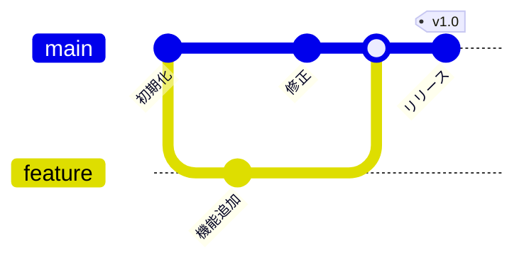

# Git 早見表

`compact` テンプレートは、表紙と目次を付けず、小さな文字と狭い余白で 1 ページに詰め込みます。

## 日常の操作

| やりたいこと | コマンド |
|---|---|
| 状態を見る | `git status -sb` |
| 変更を確認する | `git diff` / `git diff --staged` |
| 一部だけステージする | `git add -p` |
| コミットする | `git commit -m "メッセージ"` |
| 直前のコミットを直す | `git commit --amend` |
| 履歴を見る | `git log --oneline --graph --decorate` |

## ブランチ

| やりたいこと | コマンド |
|---|---|
| 一覧を見る | `git branch -vv` |
| 作って切り替える | `git switch -c feature/name` |
| 取り込む | `git merge --no-ff feature/name` |
| 付け替える | `git rebase main` |
| 削除する | `git branch -d feature/name` |

## 取り消し

| 状況 | コマンド |
|---|---|
| ステージを戻す | `git restore --staged <file>` |
| 作業ツリーの変更を捨てる | `git restore <file>` |
| コミットを打ち消す（履歴は残す） | `git revert <commit>` |
| 直前のコミットを取り消す（変更は残す） | `git reset --soft HEAD~1` |

> 共有したブランチで `reset` や `rebase` を使うと、他の人の履歴とずれます。先に相談してください。

## リモート

```bash
git fetch --prune
git pull --rebase
git push -u origin feature/name
git push --force-with-lease   # 強制する場合は、これを使う
```

## ブランチの流れ


