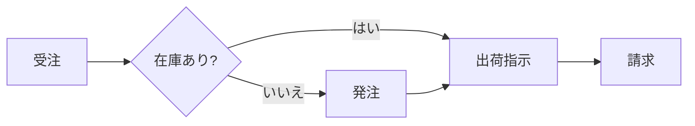
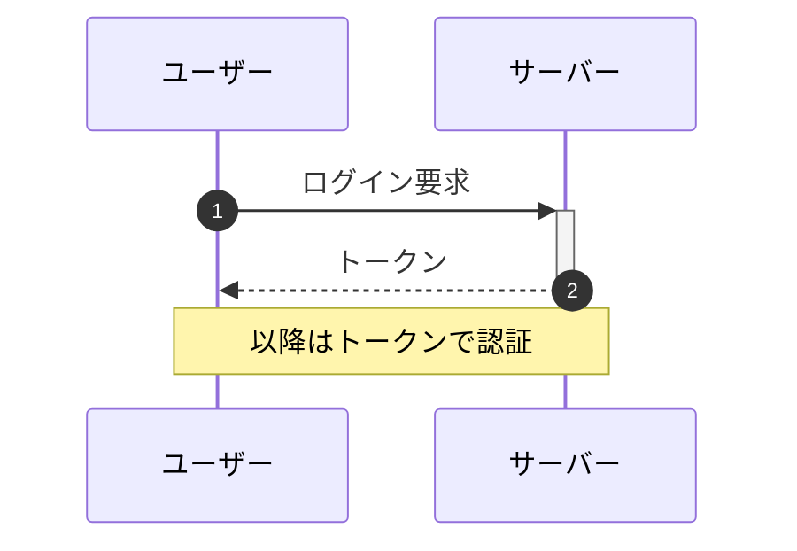
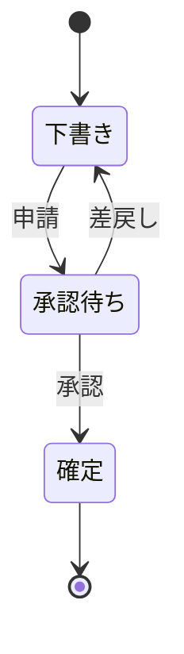
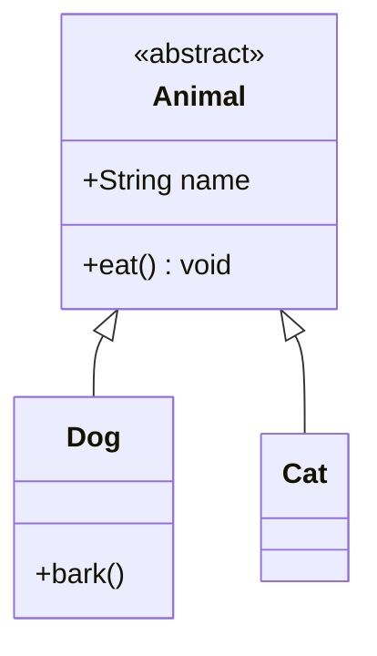
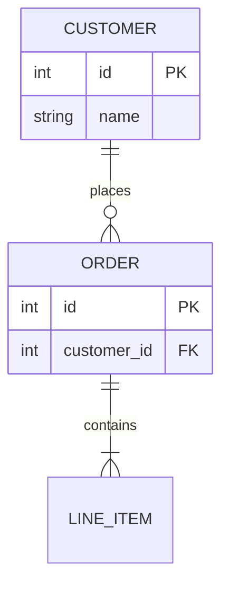
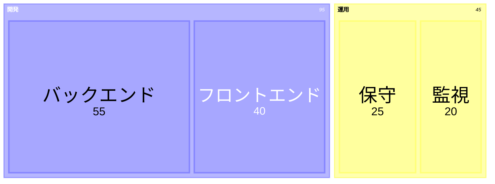
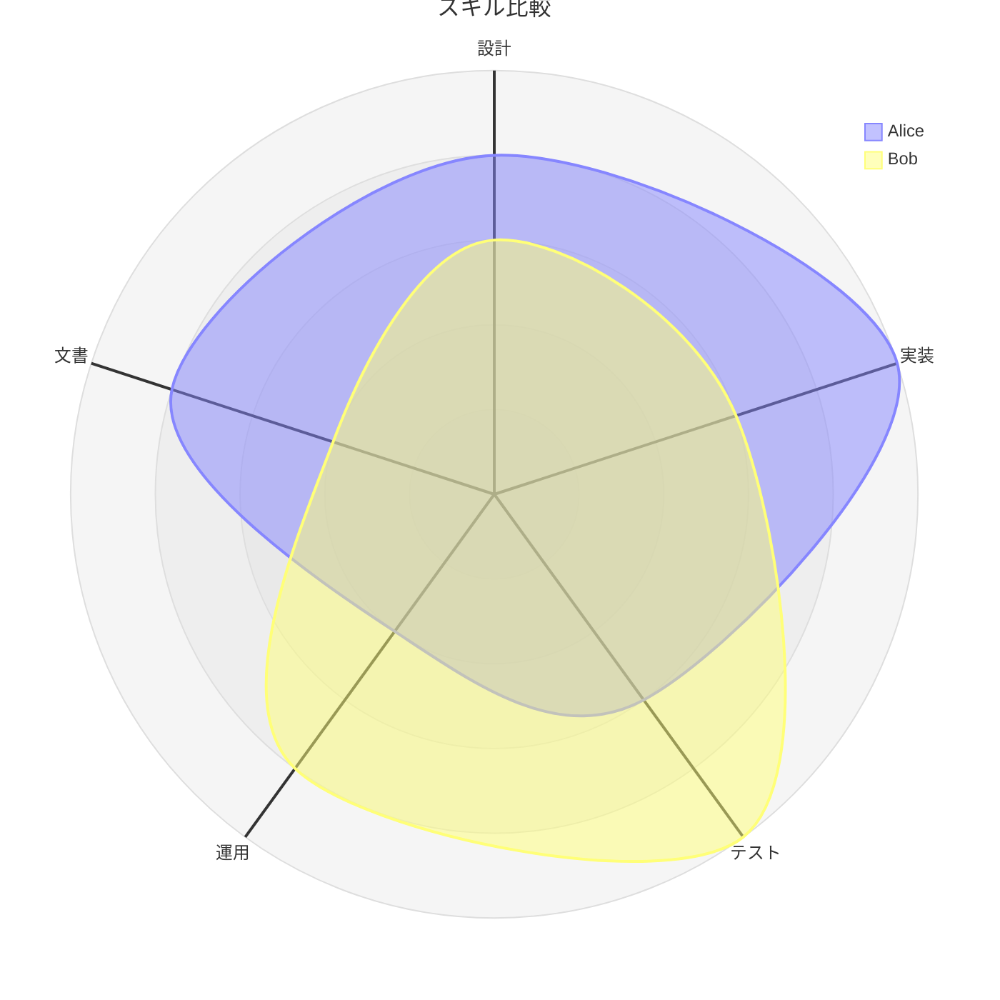
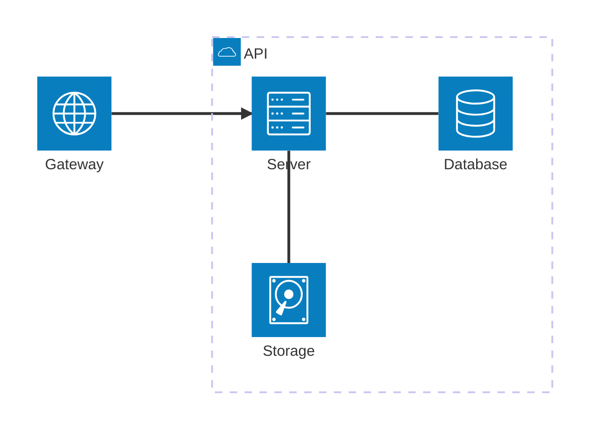

# Mermaid 図の一覧

` ```mermaid ` のコードブロックは、エンジンがそのままベクターで描画します。PDF にしても文字は選択でき、拡大しても粗くなりません。

## フローチャート



## シーケンス図



## 状態遷移図



## クラス図



## ER 図



## グラフ

```mermaid
xychart-beta
  title "月別売上"
  x-axis [1月, 2月, 3月, 4月, 5月, 6月]
  y-axis "百万円" 0 --> 120
  bar [30, 45, 60, 80, 95, 110]
  line [25, 50, 55, 85, 90, 100]
```

## ツリーマップとレーダーチャート





## アーキテクチャ図


