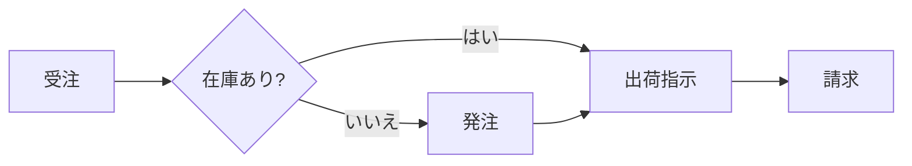
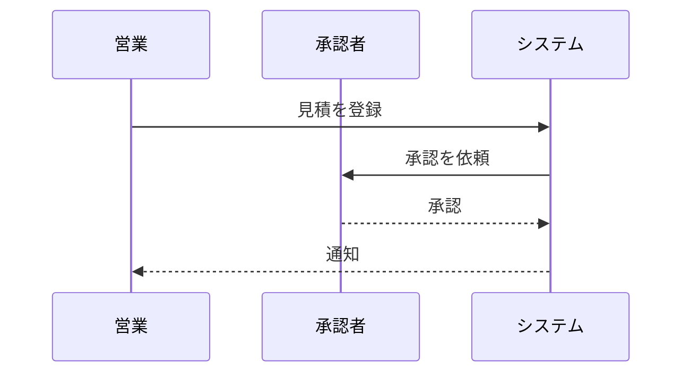
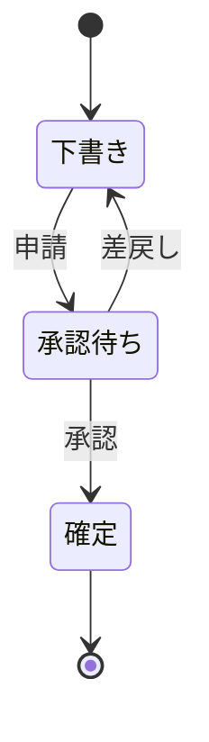

# 1. ご提案の概要

現行の受発注業務は、メールと表計算ソフトに分散しています。本提案では、受注から出荷までを 1 つの画面にまとめ、**転記作業をなくす**ことを目指します。

> 本書の金額は税別・概算です。要件確定後に正式なお見積りを提出します。

# 2. 現状と課題

| 課題 | 影響 | 優先度 |
|---|---|:---:|
| 手作業の転記 | 月 40 時間の工数 | 高 |
| 在庫情報の遅れ | 欠品・過剰在庫 | 高 |
| 承認が紙とメール | 処理に平均 3 日 | 中 |

# 3. 提案する業務フロー

受注から出荷までの流れは次のとおりです。

承認は次のやり取りで完結します。

案件の状態は次のように遷移します。

# 4. 体制とスケジュール

1. 要件定義(1 か月)
2. 開発・テスト(3 か月)
3. 移行・並行稼働(1 か月)

# 5. お見積り

| 項目 | 金額(円) |
|---|---:|
| 要件定義 | 1,200,000 |
| 開発・テスト | 4,800,000 |
| 移行支援 | 900,000 |
| **合計** | **6,900,000** |
