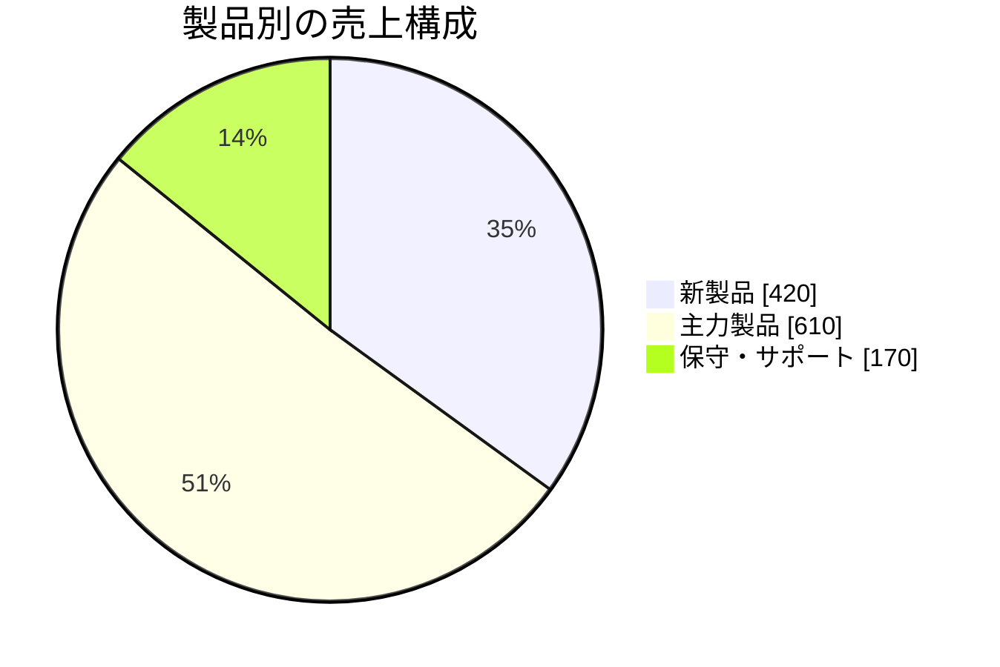
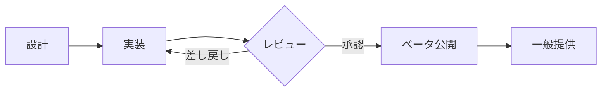

# はじめに

本書は、2026 年度第 3 四半期の製品開発部門の活動をまとめたものです。数値は速報値で、確定値は経理の締め後に更新されます。

表紙、目次、ヘッダーの題名、フッターの著者名とページ番号（`n / N`）は、フロントマターの `template: report` だけで付きます。目次の行を押すと、その見出しのページへ移動できます。

## 概要

売上は前期比で **12%** 増加し、利益率も改善しました。主な要因は次の 3 つです。

- 新製品の立ち上がりが想定より早かったこと
- 既存顧客の更新率が **94%** に達したこと
- 開発コストの見直しが進んだこと

## 主要指標

| 指標 | 第 2 四半期 | 第 3 四半期 | 前期比 |
|---|---:|---:|---:|
| 売上（百万円） | 1,070 | 1,200 | +12% |
| 営業利益（百万円） | 240 | 300 | +25% |
| 更新率 | 91% | 94% | +3pt |

> 数値は速報値です。確定値は後日、別紙で共有します。

## 売上の推移

月ごとの売上と営業利益を、棒グラフと折れ線で示します。

```mermaid
xychart-beta
  title "月別の売上と営業利益（百万円）"
  x-axis [4月, 5月, 6月, 7月, 8月, 9月]
  y-axis "百万円" 0 --> 500
  bar [320, 340, 360, 380, 400, 420]
  line [70, 75, 80, 95, 100, 105]
```

売上の内訳は、製品別に次のとおりです。



# 開発の進捗

## 新製品

新製品は、ベータ版の公開から 6 週間で、利用組織が 200 を超えました。

```ts
// 利用組織数の集計（例）
const total = organizations.filter((o) => o.active).length;
console.log(`active: ${total}`);
```

### 品質の指標

リリース判定は、次の基準で行いました。

- [x] 重大な不具合が 0 件
- [x] 主要な操作の応答が 200 ms 以内
- [ ] 海外のタイムゾーンでの検証（第 4 四半期に実施）

### 開発の流れ

開発から公開までの流れは、次の図のとおりです。



## 課題とリスク

| カテゴリ | 内容 | 影響度 | 対応 | 担当者 |
|---|---|:---:|---|---|
| 技術 | 変換が遅い文書がある | 中 | 並列化で短縮 | 開発 A |
| 品質 | 海外の時間帯が未検証 | 中 | 第 4 四半期に実施 | 品質 |
| 体制 | 兼務が多い | 高 | 2 名を採用 | 管理 |
| 契約 | 更新が年末に集中 | 中 | 早めに提案 | 営業 |
| 運用 | 夜間監視が一人に偏る | 低 | 当番表を見直し | 運用 |
| 法務 | 海外向けの規約改訂 | 中 | 法務と調整中 | 法務 |

## 今後の予定

1. 新製品の一般提供を開始する
2. 海外展開の準備を進める
   1. 現地の規約と税制を確認する
   2. 言語と通貨の対応範囲を決める
3. 更新率 **95%** を目標に、サポート体制を見直す

# 付録

## 用語

- **更新率**: 契約満了の組織のうち、継続した組織の割合
- **利用組織**: 直近 30 日に 1 度でも操作のあった組織

詳細な数表と用語集は、別紙を参照してください。関連資料は [はじめに](#はじめに) から辿れます。
