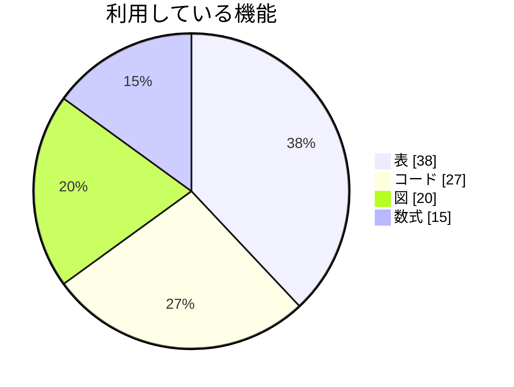
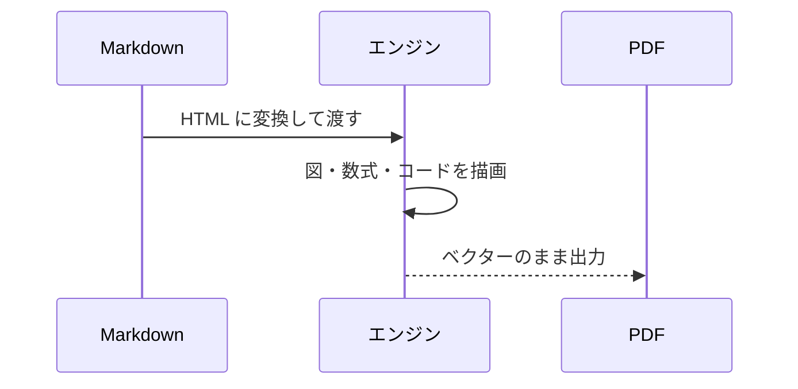

# 機能ツアー

左の Markdown と右の PDF を見比べながら、書ける要素を順に確かめられます。**見出し**、_強調_、~~取り消し~~、`インラインコード`、[リンク](https://github.com/SoraKumo001/wasm-html-to-image) は、すべて PDF 内でもそのまま使えます。

## 見出しの階層

### 第 3 階層の見出し

#### 第 4 階層の見出し

見出しの直後で改ページされないよう、自動で調整されます。

## リスト

- 箇条書き
  - 入れ子の箇条書き
    - さらに深い階層
- もう一つの項目

1. 番号付きリスト
2. 2 番目
   1. 入れ子の番号
   2. もう一つ

- [x] 完了したタスク
- [ ] これからのタスク

## 引用と区切り線

> 引用は左に線が付きます。
>
> > 入れ子の引用も書けます。

---

## 表

| 項目 | 左寄せ | 中央 | 右寄せ |
|---|:---|:---:|---:|
| 日本語の見出し | abc | 中央 | 1,200 |
| 長めの内容を入れた行 | 左に寄る | 真ん中 | 34,500 |
| **太字** と `code` | ○ | △ | × |

## コード

```ts
interface Point {
  x: number;
  y: number;
}

export const distance = (a: Point, b: Point): number => Math.hypot(a.x - b.x, a.y - b.y);
```

```python
def fib(n: int) -> int:
    """n 番目のフィボナッチ数を返す。"""
    a, b = 0, 1
    for _ in range(n):
        a, b = b, a + b
    return a
```

```json
{ "name": "wasm-html-to-image", "formats": ["pdf", "png", "webp"] }
```

```sql
SELECT customer_id, SUM(amount) AS total
FROM orders
WHERE created_at >= '2026-01-01'
GROUP BY customer_id
ORDER BY total DESC;
```

## 数式

インラインでは $e^{i\pi} + 1 = 0$ のように、ブロックでは次のように書きます。

$$
\int_{-\infty}^{\infty} e^{-x^2}\,dx = \sqrt{\pi}
$$

## 図

Mermaid の図は、コードブロックの言語に `mermaid` を指定するだけで描かれます。





## 画像

`data:` URL の SVG 画像も、ベクターのまま埋め込まれます。


## 長い段落と日本語の組版

日本語の文章は、禁則処理に沿って行が折り返されます。句読点や閉じ括弧（このような場合）が行頭に来ることはありません。英単語の `word-break` や URL、たとえば https://example.com/a/very/long/path/that/keeps/going/and/going も、はみ出さずに折り返されます。

PDF では、文字は選択でき、検索でき、フォントは必要な字形だけが埋め込まれます。

---

*この文書は、機能の見本として書かれています。*
