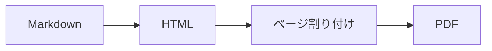

## 今日のお話

- 何ができるのか
- どう使うのか
- これからの予定

## 何ができるのか

- **Markdown** から PDF を作る
- 図（Mermaid）と数式（KaTeX）をそのまま書ける
- 文字は選択でき、ベクターのまま出力される

## 変換の流れ

## 性能の目安

| 項目 | 結果 |
|---|---:|
| 10 ページの文書 | 約 0.8 秒 |
| 図 5 点を含む文書 | 約 1.2 秒 |
| 出力サイズ | 約 400 KB |

## これからの予定

1. テンプレートを増やす
2. 日本語の組版を磨く
3. ブラウザ上のエディタを用意する

## ありがとうございました

質問は、いつでもどうぞ。
