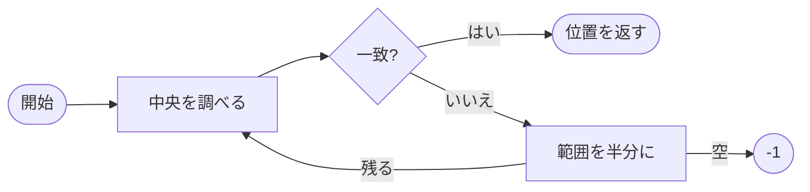

# 数式とコードの技術メモ

**概要.** このメモは、数式（`$...$` と `$$...$$`）、コードのハイライト、表、図を 1 つの文書で試すためのものです。`paper` テンプレートは、serif の本文、両端揃え、引き締まった行送りで、論文や技術ノートの体裁にします。金額の $5 や $10 は数式になりません。

# 1. 数式

## 1.1 二次方程式

$ax^2 + bx + c = 0$ の解は、判別式 $D = b^2 - 4ac$ を使って次のように書けます。

$$
x = \frac{-b \pm \sqrt{b^2 - 4ac}}{2a}
$$

## 1.2 積分と総和

$$
\int_0^\infty e^{-x^2}\,dx = \frac{\sqrt{\pi}}{2}, \qquad \sum_{k=1}^{n} k = \frac{n(n+1)}{2}
$$

## 1.3 行列と連立方程式

$$
A = \begin{pmatrix} a & b \\ c & d \end{pmatrix}, \qquad \det A = ad - bc
$$

$$
\begin{cases}
x + y = 5 \\
2x - y = 1
\end{cases}
\quad\Longrightarrow\quad (x, y) = (2, 3)
$$

## 1.4 極限と級数

$$
\lim_{n \to \infty} \left(1 + \frac{1}{n}\right)^n = e, \qquad e^{i\theta} = \cos\theta + i\sin\theta
$$

# 2. 探索アルゴリズム

## 2.1 実装

```ts
// 整列済みの配列から値を探す。見つからなければ -1 を返す。
export function binarySearch(values: number[], target: number): number {
  let lo = 0;
  let hi = values.length - 1;
  while (lo <= hi) {
    const mid = (lo + hi) >>> 1;
    if (values[mid] === target) return mid;
    if (values[mid] < target) lo = mid + 1;
    else hi = mid - 1;
  }
  return -1;
}
```

```bash
npx wasm-html-to-image memo.md -o memo.pdf --template paper
```

## 2.2 計算量

| 手法 | 計算量 | 備考 |
|---|---|---|
| 二分探索 | $O(\log n)$ | 整列済みが前提 |
| 線形探索 | $O(n)$ | 前提なし |
| ハッシュ探索 | $O(1)$（平均） | 追加のメモリが必要 |

要素数 $n = 10^6$ のとき、二分探索の比較は高々 $\lceil \log_2 n \rceil = 20$ 回です。

## 2.3 処理の流れ



# 参考文献

1. D. E. Knuth, *The Art of Computer Programming, Vol. 3: Sorting and Searching*, 2nd ed., Addison-Wesley, 1998.
2. T. H. Cormen et al., *Introduction to Algorithms*, 4th ed., MIT Press, 2022.
